# Batch Editor

Give a whole set of product images a consistent look. Align your products, set a shared canvas size, replace backgrounds, and add AI shadows — then download the results together.

## When to use it

Use Batch Editor when you need to:

- **Prepare a consistent product catalog.** Give your store’s product photos the same background, framing, spacing, and dimensions so the collection feels like a coordinated studio shoot.
- **Remove backgrounds from many images.** Create a set of transparent product cutouts for storefronts, designs, or marketing materials.
- **Apply a shared background.** Place multiple products on the same solid color or background image for a collection, campaign, or brand.
- **Standardize product placement and image size.** Align subjects with consistent padding and resize the canvas to match your store or marketplace requirements.
- **Add shadows to product cutouts.** Give isolated products a sense of depth after their background, alignment, and final size are ready.
- **Apply common edits while keeping exceptions.** Process the whole gallery together, then select individual images or smaller groups for adjustments.

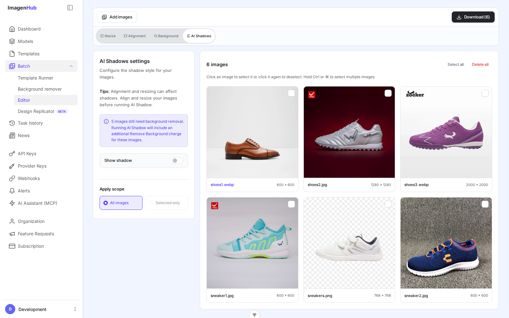

_Before: six product images with different original backgrounds and framing._

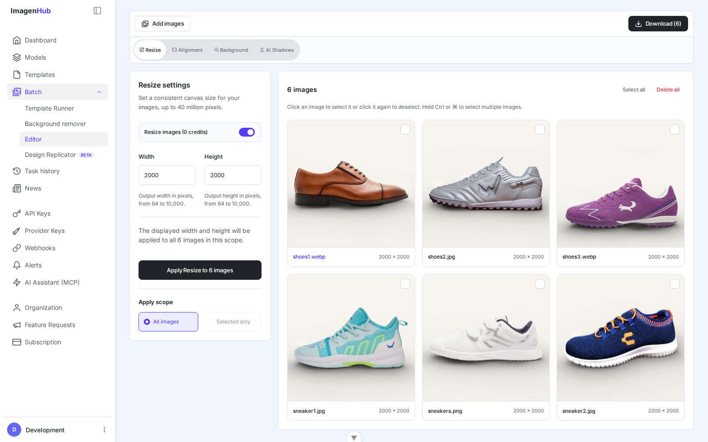

_After: the same six images with a shared studio look, consistent alignment and 2000 by 2000 pixel canvases, and AI shadows._

## How it works

Add your images and choose which ones to edit. Batch Editor uses a foreground cutout to apply background changes, alignment, resizing, and AI shadows.

- **Cutouts power foreground edits.** Background changes, alignment, resize, and AI Shadows need a usable cutout. If an opaque upload has none, Batch Editor runs Remove Background before the first edit and reuses the cutout for later edits.
- **Transparent uploads are reused.** Batch Editor recognizes transparent PNG cutouts and skips the removal model.
- **Check charges before processing.** See [How credits work](#how-credits-work) for details.
- **Workflow tip:** A good starting workflow is Remove Background (if needed) → Change background → Align → Resize → Add AI Shadow. This sequence is optional, not a requirement. When possible, add the shadow after alignment and resizing, because those changes can affect how it looks.

### Before you start

Sign in to ImagenHub, then open **Batch → Editor** in the sidebar. You can also go directly to Batch Editor. You do not need to create a template or enter an API key to use this page.

- Prepare up to 250 images, each 10 MB or smaller.
- Use image files your browser can open. For an existing transparent cutout, use a PNG that preserves its transparency.
- Check the credit estimate shown beside an action before starting processing. See [How credits work](#how-credits-work) below.

### 1. Add your images

Click **Add images** and choose the files from your device. You can also drag files onto the editor or paste an image from your clipboard.

Your files appear in the gallery with their names and dimensions. Use **Add images** again whenever you need more files. Duplicate files are skipped.

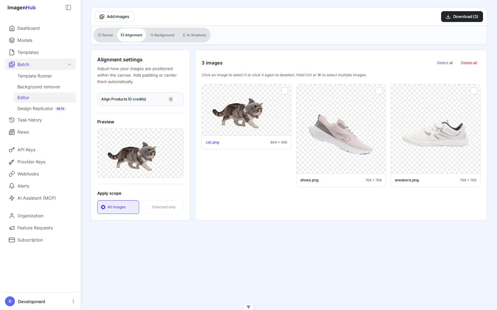

_The checkerboard indicates transparent areas. A white background is still a background, not transparency._

### 2. Choose which images to edit

The **Apply scope** controls at the bottom of the settings panel decide which images receive your next changes:

- **All images** applies changes to every image in the gallery.
- **Selected only** applies changes to the selected images.

A normal click on an unselected image selects that image only, replacing the previous selection. To select several images, hold **Ctrl** and click each one on Windows, or **⌘** and click on Mac. Click a selected image again to deselect it.

Use **Select all** to select the whole gallery, or **Clear selection** to start a new selection.

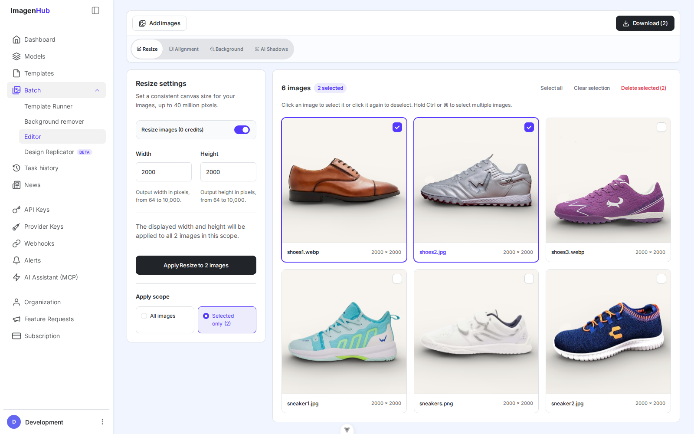

_Two selected images, two download targets. Review Apply scope before changing a setting._

Selecting part of the gallery automatically switches the scope to **Selected only**. Clearing the selection, or selecting every image, switches it to **All images**. You can change the radio option yourself. The number on **Download (N)** is the number of images that will be included.

Edits already applied to an image stay with it when you change the selection. If the current group has different settings, you may see **Multiple values**. Choose the value you want to use for that group.

### 3. Remove or replace backgrounds

Open **Background** and turn on **Remove background**. Wait for the subject to be isolated, then choose how the space behind it should look.

#### Step 1 · Remove Background

This first stage creates only the foreground cutouts. The original background is removed so the products are ready for the next steps.

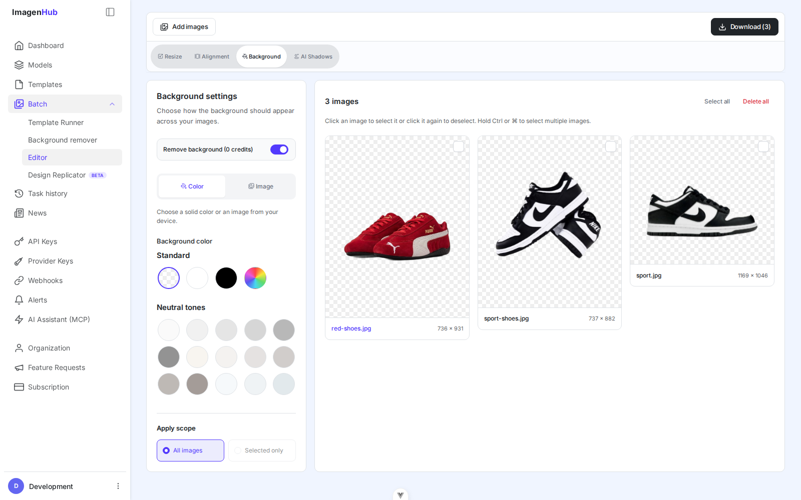

_Step 1 result: the original backgrounds are removed from all three products._

#### What the background settings mean

| Setting | What it means |
| --- | --- |
| Remove background | Separates the subject from its original background and enables the replacement background controls. If the cutout is already available, it is reused. Turning this off restores the original background, including any original transparency. |
| Background type: Color | Places a solid color or a transparent background behind the cutout. |
| Background color | Choose a preset swatch or a custom color. The checkerboard swatch means transparent, so there is no solid backdrop in the downloaded PNG. |
| Custom color: HEX / RGB / HSL | Different ways to specify the same color. HEX uses a code such as `#FFFFFF`; RGB uses red, green, and blue channels; HSL uses hue, saturation, and lightness. Click **Apply color** to confirm the custom choice. |
| Background type: Image | Uses a file from your device as the backdrop. It fills the canvas and crops centrally where needed, rather than stretching the image out of proportion. |

#### Step 2 · Change the background

Choose **Color**, then select the checkerboard swatch for transparency or a color swatch for a solid background. To use a brand color, open **Choose a custom color**, enter the color, and click **Apply color**.

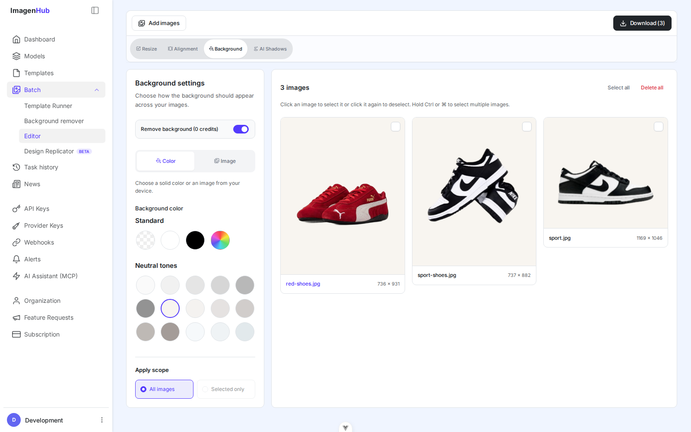

_Step 2 result: the same cutouts now share a clean studio background._

#### An image from your device

Choose **Image** and select a background file. The background fills each output canvas, cropping from the center when its shape differs from the canvas. Check the preview if the background has details near its edges.

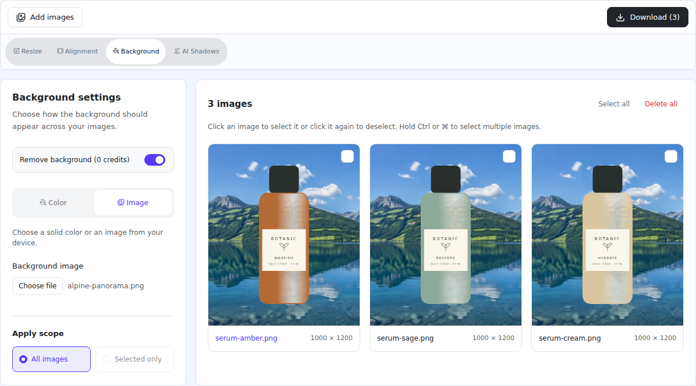

_One background image can be used across the current scope. Its visible crop depends on each image’s canvas shape._

Turn **Remove background** off to keep the original image background. For an upload that was already transparent, keeping the original preserves that transparency. A new color or image background is used while **Remove background** is enabled.

### 4. Align your products

Use **Alignment** to position each product consistently within its canvas.

- Open **Alignment** and check the apply scope.
- Turn on **Align Products**.
- Choose **Center** for equal padding on all sides, or **Custom** to set the top, right, bottom, and left separately.
- Adjust the padding from 0% to 40%. More padding leaves more space around the subject. The preview updates as you change the settings.

#### What the alignment settings mean

| Setting | What it means |
| --- | --- |
| Align Products | Turns subject alignment on or off. Off keeps the original placement; on fits and positions the detected subject within the padded area. |
| Center | Uses one Padding value for all four sides, then centers the subject in the remaining area. |
| Custom | Lets you reserve a different amount of space on each side. The subject is fitted and centered within the remaining area. |
| Padding · 0–40% | The minimum space reserved at each edge. More padding generally makes the subject smaller within the canvas. A value of 0% reserves no margin. |
| Padding top / right / bottom / left · 0–40% | Each value reserves space on that side. Top and bottom are percentages of canvas height; left and right are percentages of canvas width. For example, 10% left padding on a 2000 px canvas reserves 200 px on the left. |

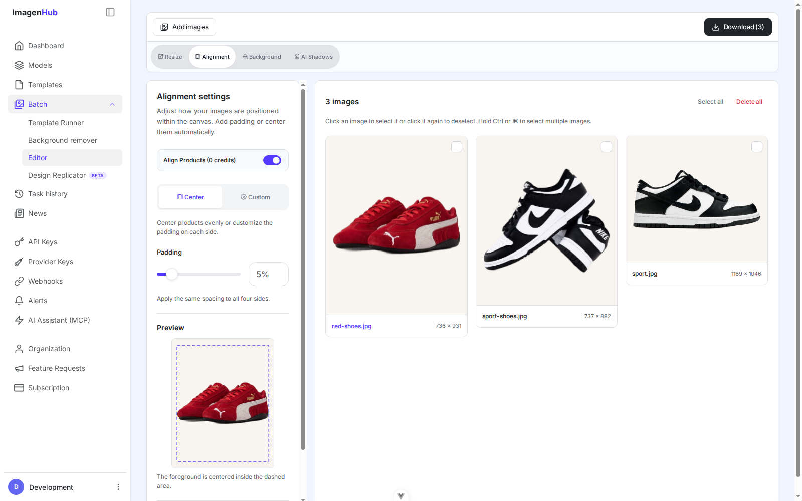

_Step 3 result: the products are centered on the shared background with consistent spacing._

Alignment changes the subject’s placement, not the visible background. Use **Background** when you also want to replace the original backdrop.

Turn **Align Products** off to return to the original placement. There is no separate Apply button for alignment.

### 5. Set the canvas size

Open **Resize** to give the final files consistent dimensions, such as 2000 × 2000 px. Width and height are the output canvas size in pixels.

- Turn on **Resize images**.
- Enter the output **Width** and **Height** in pixels.
- Click **Apply Resize to N images**.
- Check the dimensions shown beneath each affected image.

#### What the resize settings mean

| Setting | What it means |
| --- | --- |
| Resize images | Enables a new output canvas size for the current scope. Turning it off removes the applied resize from those images. |
| Width / Height | The final file’s width and height in pixels, rather than the preview’s display size. Use equal values for a square, such as 2000 × 2000; use 1600 × 2000 for a portrait canvas. |

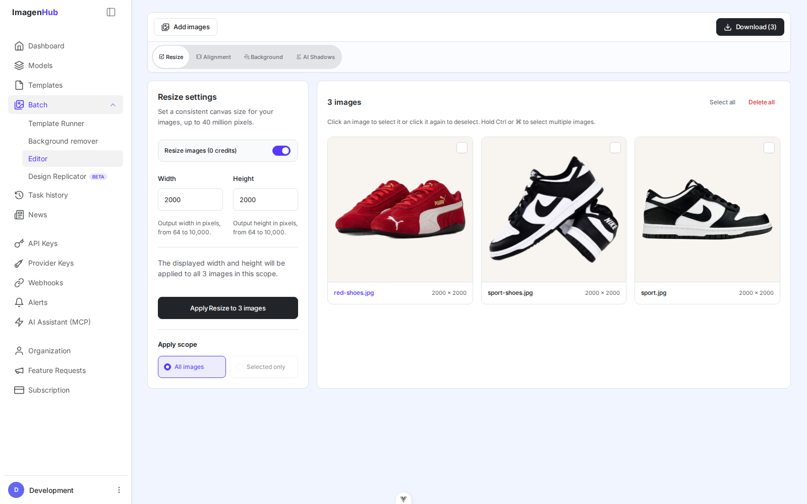

_Step 4 result: all three aligned products now use the same 2000 × 2000 px canvas._

The width and height are a draft until you click **Apply Resize**. Download uses the last applied size. Turning **Resize images** off removes the resize from the images in the current scope.

Each dimension must be a whole number from 64 to 10,000 pixels, and the output must contain no more than 40 million pixels in total. For example, 10,000 × 4,000 is within the limit; 10,000 × 10,000 is not. Fix any validation message before applying the resize.

Resize sets the output canvas. Use **Alignment** to control how the subject fits within it.

### 6. Add AI shadows

Finish alignment and resizing before generating a shadow when possible. Those edits can change the subject’s scale or placement and affect the shadow’s appearance.

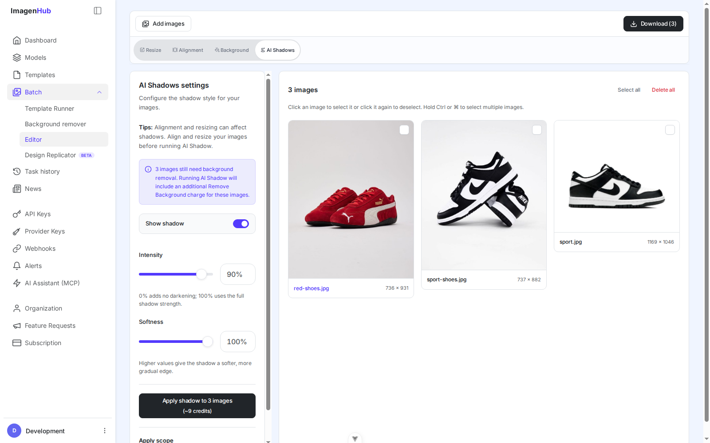

_Before generating shadows, Batch Editor warns when the uploaded images need background removal and includes that model call in the estimate._

- Open **AI Shadows** and turn on **Show shadow**.
- Set **Intensity** to control the strength of the shadow. At 0% it adds no darkening; 100% uses the full strength.
- Set **Softness** to control the edge. Higher values make the edge softer.
- Review the credit estimate, then click **Apply shadow to N images**.
- Wait for processing to finish before switching tools or downloading.

#### What the shadow settings mean

| Setting | What it means |
| --- | --- |
| Show shadow | Includes the prepared shadow in the preview and download. Turning it on alone does not generate a shadow; use **Apply shadow**. Turning it off hides the shadow and excludes it from export. |
| Intensity · 0–100% | Controls the shadow’s strength. 0% adds no darkening, and 100% uses the full strength. Lower values give a lighter, more subtle result. |
| Softness · 0–100% | Controls how gradually the edge fades. Lower values give a firmer edge; higher values give a softer edge. |
| Apply shadow to N images | Runs shadow generation using the displayed settings for the current scope. Review the estimated credit cost beside the button before applying. |

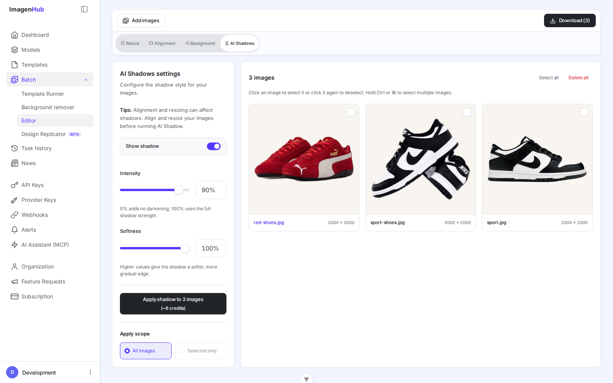

_Set Intensity and Softness, then review the displayed estimate before applying._

Changing **Intensity** or **Softness** prepares the next shadow. An existing shadow stays visible until a replacement is ready. Click **Apply shadow** to generate the new version. Turn **Show shadow** off to exclude the shadow from both preview and download.

If an image has no cutout, clicking **Apply shadow** automatically starts background removal before generating the shadow. A notice appears so you can review the additional step before processing. If the cutout is ready, the editor reuses it. This preparation does not automatically switch your chosen visible background mode.

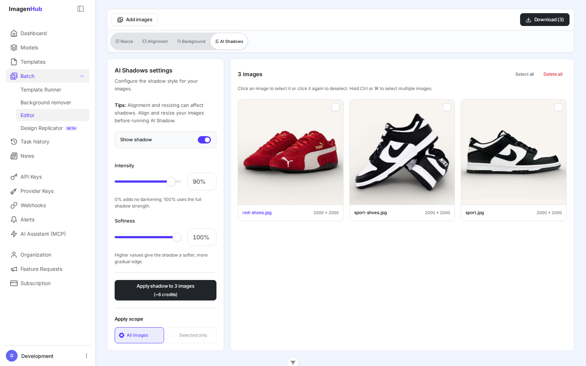

_Step 5 result: AI shadows are generated after the products have been aligned and resized._

### 7. Download or reload

- Review the gallery and finish any pending **Apply Resize** or **Apply shadow** action.
- Set **Apply scope** to **All images** or **Selected only**, depending on what you want to save.
- Check the count on **Download (N)**, then click it.
- Keep the page open while **Preparing your download** is displayed.

The editor saves an `edited-images.zip` file containing the successfully rendered images as PNG files. Filenames keep their original names with a `.png` extension; duplicate names receive a number.

If some images fail, the ZIP still contains the successful results and a message tells you how many failed. Review the affected cards, retry the relevant step, then select those images and download them again. If every image fails, no ZIP is saved.

If **Show shadow** is enabled but no shadow has been applied, run **Apply shadow** first or turn the switch off before downloading.

Your images and edits belong to the current editor session. Reloading the page or leaving the editor clears them. Download the results you want to keep before continuing elsewhere.

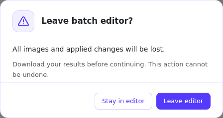

_The confirmation gives you a chance to stay in the editor before the session ends._

## Good to know

- **Select multiple images:** Click one image to select it; hold **Ctrl** (or **⌘** on Mac) while clicking to select several.
- **Wait for processing to finish.** Tool switching pauses while effect work is queued or running. Retry failed work from the affected image’s card.

## How credits work

The estimates in the editor depend on your current scope and which images still need processing. They can change as cutouts are detected or work finishes. The amounts shown in this guide are examples; use the estimate in your own editor.

| Action | What to expect |
| --- | --- |
| Resize | 0 credits when a cutout is ready. If the uploaded image still has a background, the editor must prepare the foreground first. |
| Align Products / Remove background | 0 credits when a cutout is ready. Otherwise, the Remove Background model runs to prepare the subject and may incur a charge. Eligible transparent uploads and cutouts already prepared in this session are reused. |
| Change color or background image | 0 credits when a cutout is ready. Choosing a color or background image reuses it. If an image still needs a cutout, background removal runs first and may incur a charge. |
| AI Shadows | Paid shadow generation. If no cutout is ready, the editor automatically removes the background first and includes that additional cost in the estimate. |
| Download | Rendering itself is 0 credits. Any required background-removal preparation can still incur its processing cost. |

## Next steps

Start with a small group of images, check the result, then apply the same settings to the rest. When you are ready to explore other ImagenHub workflows:

- [Templates](./templates.md) — save reusable generation presets.
- [Dynamic Upload Ratio](./dynamic-upload-ratio.md) — let a template follow the shape of the image it receives.
- [Getting Started](./getting-started.md) — explore the wider ImagenHub workflow.
