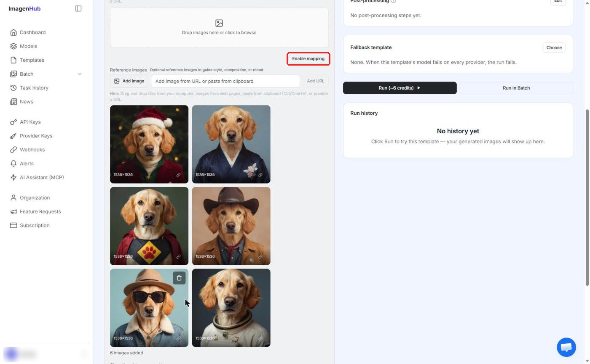
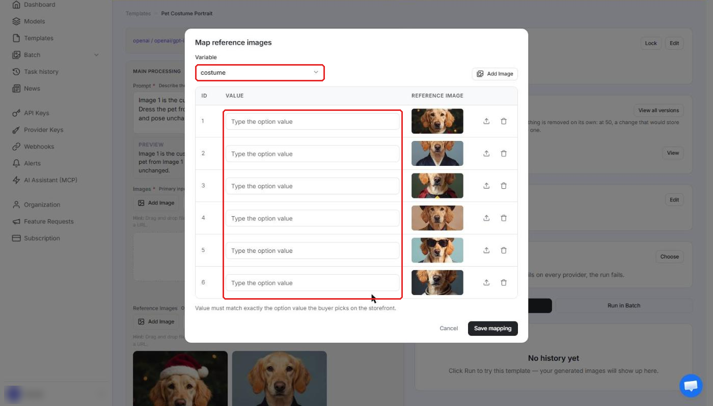
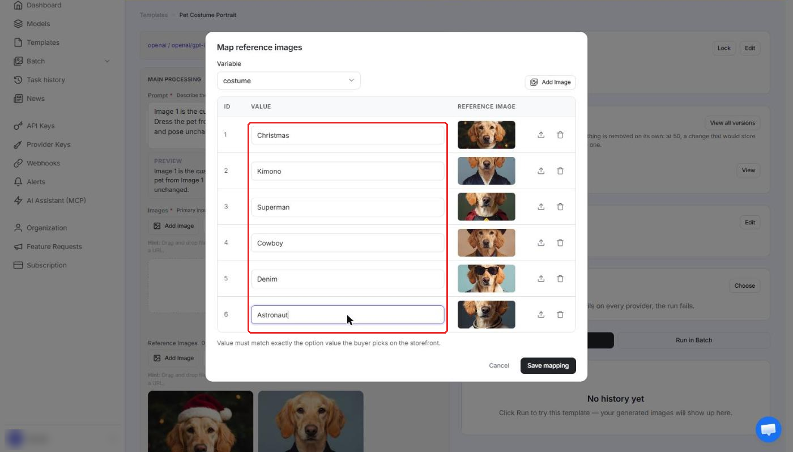
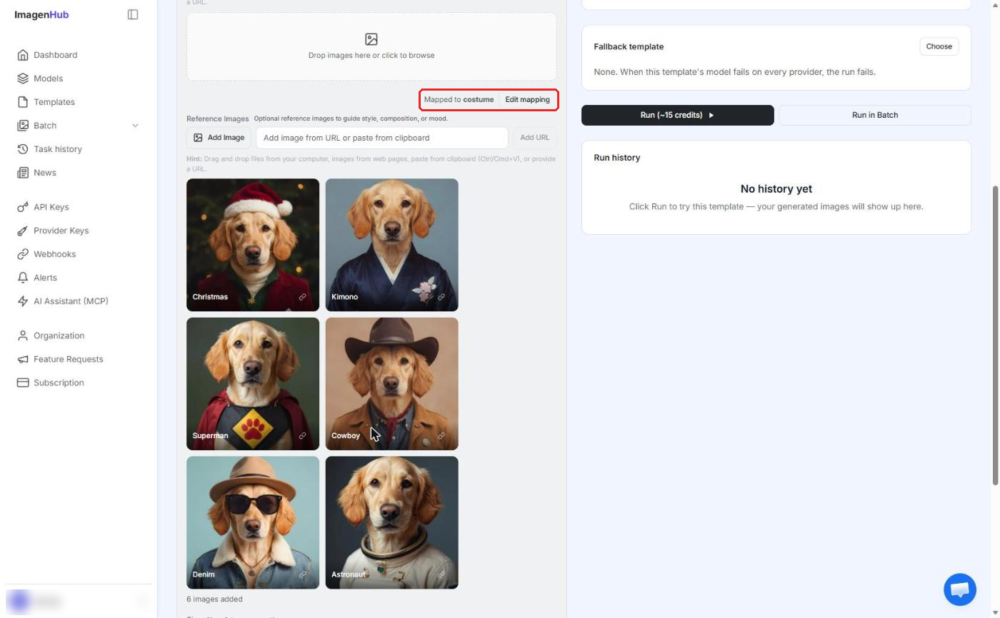
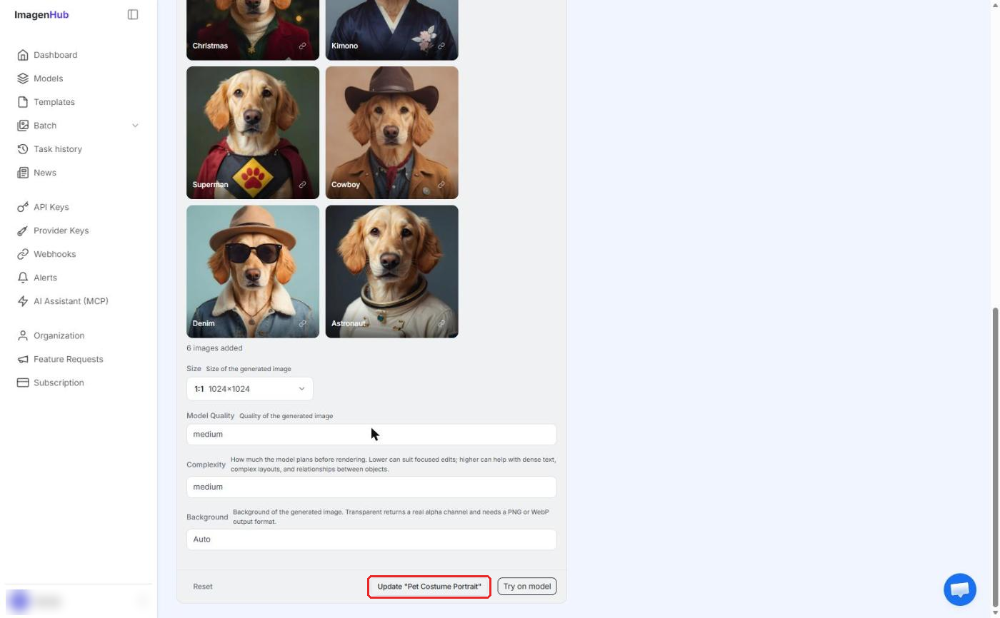
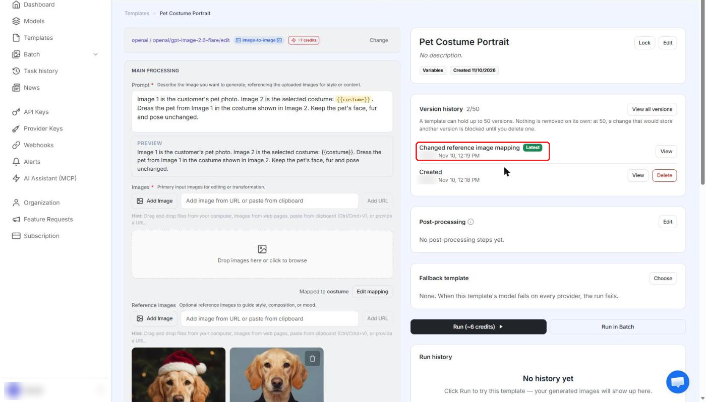
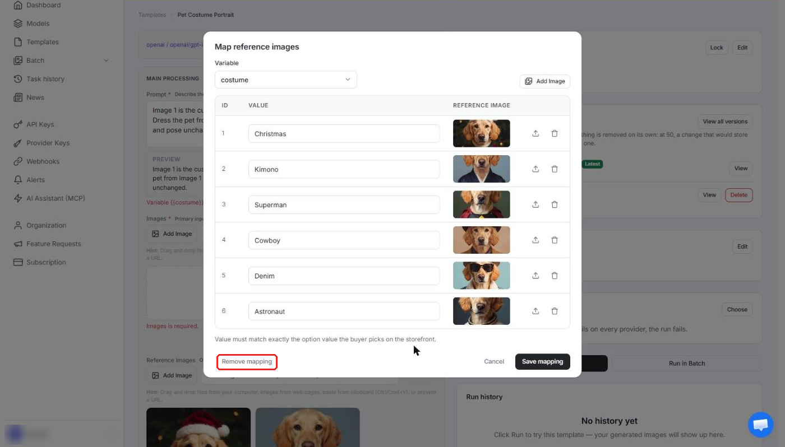
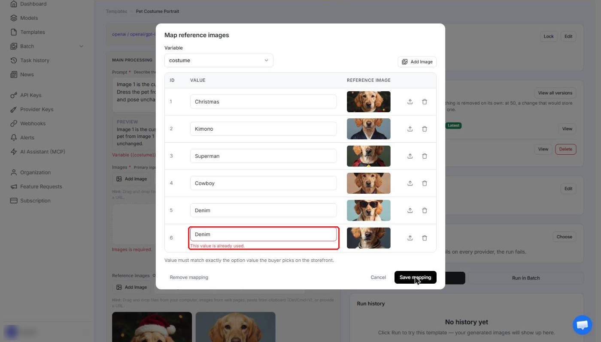

# Reference Image Mapping

Say you sell one product with dozens of costumes, and many of them look almost the same: only the gloves, an accessory or a pattern is different. Until now you had two ways to handle that, and both had a cost:

- **One template with every costume image attached.** You number the images in the prompt and the model picks one itself. The more costumes you add, the more often it picks the wrong one or mixes details from two costumes.
- **One template per costume.** Every option on your storefront has to be linked to its own template by hand. It works, but it is slow to set up and easy to get wrong.

**Reference Image Mapping** replaces both. You keep **one template and one prompt** for the whole campaign, and you tell ImagenHub which reference image belongs to which option value. When a buyer picks an option, ImagenHub sends the model **only the image mapped to that option**.

::: warning Read this guide before you use the feature
Reference Image Mapping is **not turned on for every account**. ImagenHub enables it **only for customers who ask for it**. If you do not see the **Enable mapping** button in your template, your organization is not enabled yet. Contact ImagenHub support and ask for "Reference Image Mapping".

Please read this whole guide before you set it up. A mapping that does not match the options on your storefront makes the run fail.
:::

## At a glance

| | |
|---|---|
| What it does | Sends only the reference image that matches the option the buyer picked |
| Where you set it up | Template page, **Reference Images** section, button **Enable mapping** |
| Who can use it | Organizations that ImagenHub has enabled on request |
| Limits | 1 variable per template, up to 250 values, exactly 1 image per value |
| Works with | Models that have a **Reference Images** field |
| Not available in | The Playground |

## When to use it

Use it when **the same generation should use a different reference image depending on one option**, for example costume, outfit, pattern, frame or style.

Do not use it for a reference image that must be sent on every run. While mapping is on, **every reference image in the template must be assigned to an option value**, so there is no "always send" image.

Templates that do not use this feature behave exactly as before. Turning it on for one template changes nothing for your other templates.

## How it works

When a buyer picks an option and uploads a photo, ImagenHub does this:

1. It reads the value of the variable, for example `Cowboy`.
2. It finds the row in your mapping where **Value** is `Cowboy`.
3. It sends the model **the buyer's photo first, then the image mapped to `Cowboy`**.
4. Images mapped to other values (`Christmas`, `Kimono` and so on) are **not sent**.

The model always receives the images in the same order: **the buyer's photo first, the mapped image second.** Because of this fixed order you can write the prompt as "Image 1 is the customer's photo, Image 2 is the selected costume".

The text variable keeps working as before. <code v-pre>{{costume}}</code> in the prompt is still replaced with the selected value, so the prompt can also name the option.

## Before you start

You need three things:

1. **The feature enabled for your organization.** See the warning at the top of this page.
2. **A model that has a Reference Images field.** Some models only have an **Images** field. For example, Nano Banana 2.1 Edit has only **Images**, so there is nothing to map. In our example we use **GPT Image 2.6 Flare Edit**, which has both **Images** (the buyer's photo) and **Reference Images**.
3. **A variable for the option in your prompt**, written as <code v-pre>{{name}}</code>, for example <code v-pre>{{costume}}</code>. The name must be the same name your storefront uses for that option, and the values your storefront sends are what ImagenHub matches against your mapping.

## Set it up

### Step 1. Create the template and save it

Create the template as usual and write one prompt for the whole campaign. Use the variable for the option and refer to the images by position:

```
Image 1 is the customer's pet photo. Image 2 is the selected costume: {{costume}}.
Dress the pet from Image 1 in the costume shown in Image 2.
Keep the pet's face, fur and pose unchanged.
```

Upload **all** your costume images in the **Reference Images** field, then save the template.

::: tip The button is not in the New Template form
The **Enable mapping** button does not appear while you are creating a new template. Save the template first, then open it from the **Templates** page. The button is on the template page.
:::

### Step 2. Click Enable mapping

On the template page, find the **Reference Images** section. Above it, on the right, click **Enable mapping**.



### Step 3. Choose the variable and type the values

A popup called **Map reference images** opens.

- **Variable** is the prompt variable the mapping applies to. Here it is `costume`.
- The table has one row for each reference image you already uploaded. It has 3 columns: **ID** (row number), **Value** and **Reference image**. The **Value** boxes start empty.



Type the option value for each image, next to its picture:



Rules for the table:

- **Value must match exactly the option value the buyer picks on your storefront.** This note is also shown under the table. Compare it character by character, and copy the value from your storefront instead of retyping it. `Cowboy` and `Cowboy hat` are different values.
- **Each Value has exactly 1 image.**
- **Maximum 250 Value rows** per variable.
- **Every reference image in the template must be assigned to a Value.** If one image is left without a Value, the template cannot be saved.
- Each image follows the usual reference image upload rules: up to 10MB per image, optimized automatically.
- You can add more images from the popup with **Add Image**, or in the **Reference Images** section of the template page.

### Step 4. Click Save mapping

**Save mapping** closes the popup and keeps your changes in the template page. Two things change on the page:

- A label **Mapped to costume** and a button **Edit mapping** appear above the Reference Images.
- Each reference image now shows its **Value** as a label.



### Step 5. Click Update to save the template

::: warning Nothing is saved until you click Update
**Save mapping** only keeps your changes in the page. The mapping is stored when you click **Update "your template name"** at the bottom of the template. If you leave the page without clicking **Update**, the mapping changes are lost.
:::

Scroll to the bottom of the left panel and click **Update "Pet Costume Portrait"** (your template name will be shown in the button). A message **Template updated!** appears.



Every save creates one new version of the template. The change is logged as **Changed reference image mapping** in **Version history**.



### Step 6. Test with real option values

Test the template from your storefront with several different option values, including costumes that look similar. Reference Image Mapping is applied when the template runs from your storefront or API. It is **not applied in the Playground**, so do not use the Playground to test it.

## Worked example

Campaign: a pet portrait where the buyer picks a costume. Template: **Pet Costume Portrait**. Model: GPT Image 2.6 Flare Edit. Variable: `costume`.

| ID | Value | Reference image |
|---|---|---|
| 1 | Christmas | Dog in a Santa hat and red jacket |
| 2 | Kimono | Dog in a navy kimono |
| 3 | Superman | Dog in a red cape with a paw badge |
| 4 | Cowboy | Dog in a brown cowboy hat and jacket |
| 5 | Denim | Dog in a hat, sunglasses and a denim jacket |
| 6 | Astronaut | Dog in a white space suit |

A buyer picks **Cowboy** and uploads a photo of their pet. The model receives the pet photo (Image 1) and the Cowboy image (Image 2). The other five costume images are not sent.

## What happens when the value does not match

If the value sent for the variable is **not in your mapping**, the run **fails** with the message **No reference image mapped**, and the credits for that run are **refunded**. ImagenHub never guesses a costume for you.

This is why the **Value** column must match your storefront exactly. When you add a new option on your storefront, add the same value to the mapping.

## Using it with a fallback template

If your template has a [fallback template](./fallback-template.md), the fallback follows these rules:

| Situation | Result |
|---|---|
| The fallback has its own mapping for that variable | The fallback's own mapping is used |
| The fallback has no mapping | The image already chosen by the main template is used |
| The fallback uses a model without a Reference Images field | No mapped image is sent |

## Edit, remove, copy and lock

- **Edit mapping.** Click **Edit mapping** to change values or images. Click **Update** afterwards to save.
- **Remove mapping.** Open **Edit mapping** and click **Remove mapping** (bottom left of the popup). The reference images stay in the template as normal reference images. Click **Update** to save, as with any other change.
  

- **Version history.** Every mapping change is logged in the template history and creates a version. **Revert** restores the mapping together with the version.
- **Duplicate and Import.** The mapping is part of the template and is copied with it.
- **Locked templates.** You cannot edit the mapping while the template is locked.
- **Changing the model.** If you switch a template that has a mapping to a model without a Reference Images field, **Save is blocked** with a message. Switch back to a supported model, or remove the mapping first.
- **If the feature is turned off for your organization.** The **Enable mapping** and **Edit mapping** buttons are hidden, so you cannot edit mappings. Templates that already have a mapping keep working: the mapping is still applied on every run, so your storefront does not return the wrong costume.

## Error messages when you save the mapping

The popup checks your table when you click **Save mapping**. If something is wrong, the popup stays open and shows the problem under the row.

**Empty value:** the message is **Enter a value.**


**Duplicate value:** the message is **This value is already used.**



Other checks stop the save as well: a row without an image, more than 250 rows, and a reference image that is not assigned to any Value.

## Troubleshooting

| Problem | What to check |
|---|---|
| I do not see **Enable mapping** | First, check that you are on the template page and not in the New Template form: save the template, then open it. Then check that the model has a **Reference Images** field. If both are fine, your organization is not enabled yet. Contact ImagenHub support. |
| The popup shows **Enter a value.** | A Value box is empty. Type the option value for that image. |
| The popup shows **This value is already used.** | Two rows have the same Value. Each Value can have only one image. |
| The template will not save | Look for an empty Value, a repeated Value, a row without an image, more than 250 rows, or a reference image without a Value. |
| My mapping disappeared after I left the page | You clicked **Save mapping** but not **Update**. Do the mapping again and click **Update**. |
| Save is blocked after changing the model | The new model has no Reference Images field. Pick a supported model or remove the mapping. |
| A run fails with **No reference image mapped** | The value your storefront sent is not in the mapping. Compare it with the **Value** column character by character, then add the missing row. The credits are refunded. |
| A buyer got the wrong costume | Only the image mapped to the picked value is sent. Check that the right image is on that value, then check the wording of your prompt. If it is still wrong, send the task ID to ImagenHub support. Each run records the option value and the image that were used. |
| I need an image that is always sent | Not supported while mapping is on. Every reference image must be assigned to a Value. |
| It does not work in the Playground | Correct. The mapping is not applied in the Playground. Test from your storefront or API. |

## Good to know

- **It can lower the cost.** On models that charge by the number or size of input images, sending one reference image instead of all of them lowers the cost. The exact price depends on the model.
- **One variable per template.** If you have two options that each need their own image, for example costume and background, mapping is not available for both in the same template.
- **Keep values stable.** Renaming an option on your storefront without changing the Value in the mapping makes those runs fail with **No reference image mapped**.

## Next steps

- [Templates](./templates.md): how reusable presets store their inputs.
- [Fallback Template](./fallback-template.md): what runs when the main model fails.
- [Image Generation](./image-generation.md): the flow that mapping plugs into.
