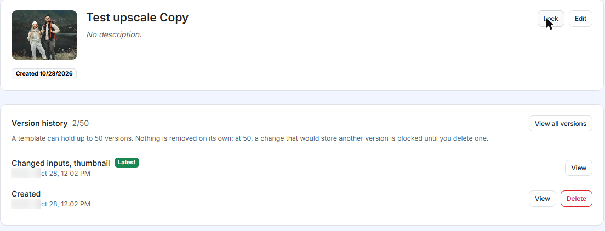
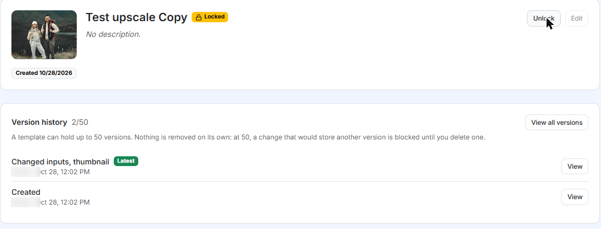
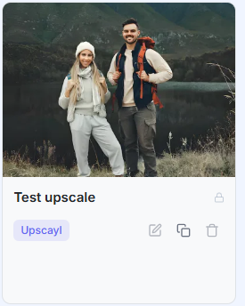
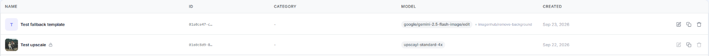
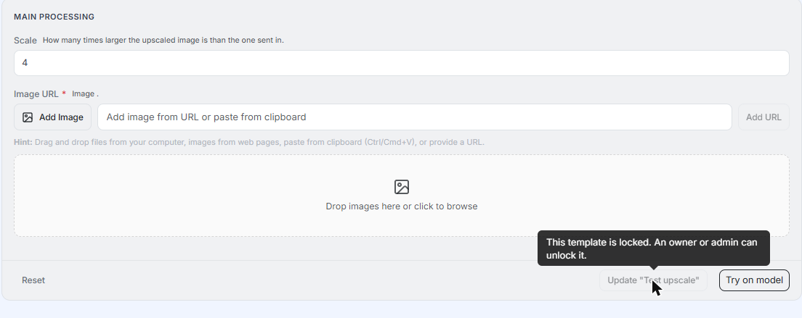
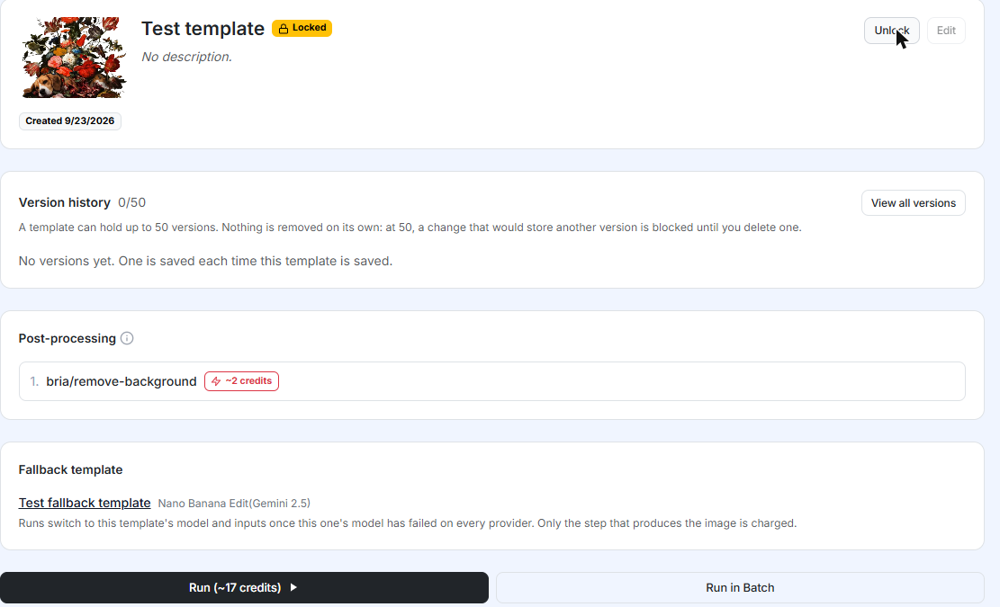
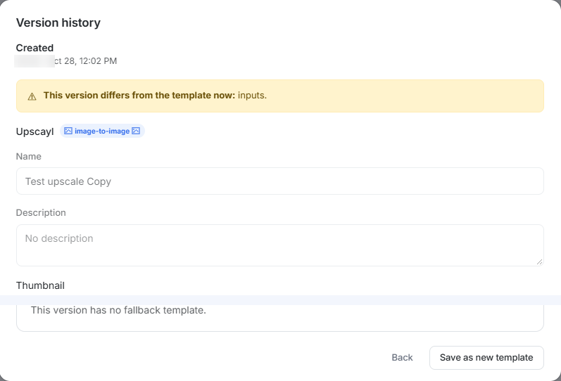
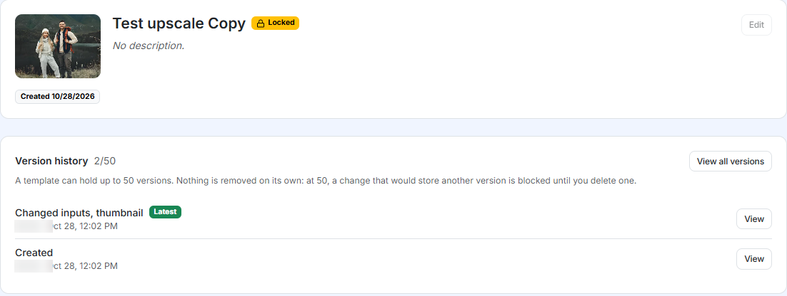
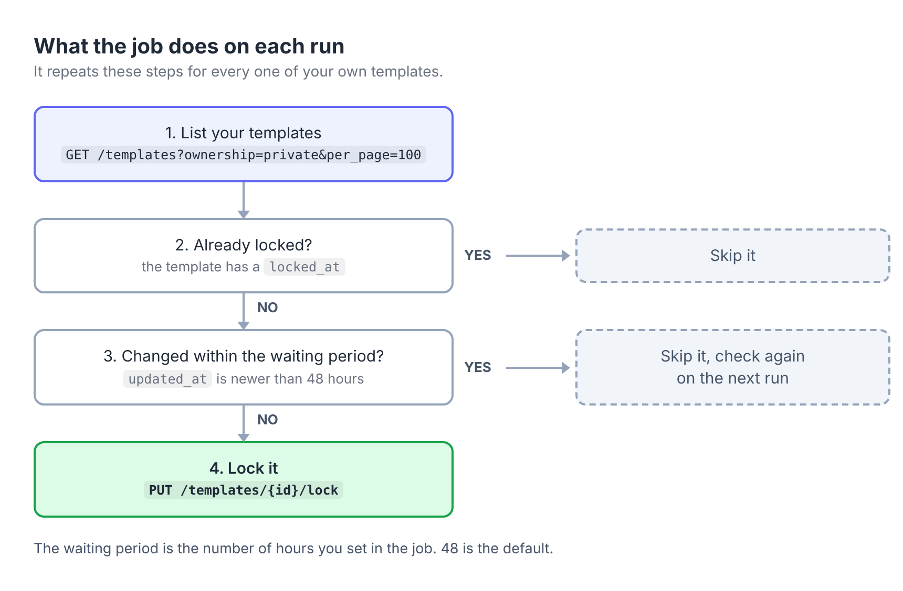
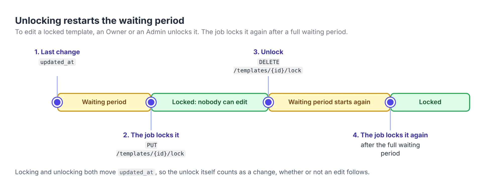

# Template Lock

A template is only as good as its last edit. One stray change to a prompt, a model, or a fallback can quietly alter every image the template produces afterwards, and if the template sits behind a live storefront or an API integration, nobody notices until customers do.

**Template lock** freezes a finished template. While it is locked, nobody can change it, not even owners and admins, but it keeps running exactly as before.

## When to use it

- **Approved templates behind a live flow**: a storefront, or your own API integration. Once a template is tuned and approved, lock it so it cannot drift.
- **Teams with several editors**: Editors can build and edit templates. Locking lets owners and admins decide when a live template is allowed to change.
- **Handing a template over**: you finish a template for your team and want it to stay exactly as delivered.

If you are still iterating on a template, leave it unlocked. Lock is entirely opt-in, and a template that was never locked behaves exactly as it always has.

## How it works

Locking is a switch on the template. Only an **Owner** or an **Admin** can turn it on or off (see [Roles](./organization.md#roles)). Editors and Viewers cannot. Your organization's API keys can turn it on or off too: see [Locking through the API](#locking-through-the-api).

| While a template is locked | What happens |
| --- | --- |
| Edit any part of the template (name, description, thumbnail, model, inputs, post-processing, fallback template) | Blocked for everyone, including owners and admins |
| Delete the template | Blocked |
| Revert to an older version | Blocked |
| Delete an old version | Blocked |
| Run the template (Playground, API, your connected apps) | Works as usual |
| Duplicate the template | Works. The copy is a new template that is not locked |

The lock is enforced everywhere a template can be changed: the web app, the AI Assistant (MCP), and the API.

::: tip Locking does not use up a version
Locking and unlocking do not add an entry to the version history. A template with 2 versions still shows 2/50 after you lock it, so locking never uses one of the 50 version slots.
:::

## Locking a template

1. Open the template you want to protect.
2. Click **Lock**, next to **Edit** at the top right of the template page.
3. A message confirms it: "Template locked. Nobody can change it until it is unlocked."

There is no confirmation dialog: the template locks as soon as you click.



Once locked, the title shows a **Locked** badge, the button becomes **Unlock**, **Edit** is greyed out, and the **Delete** buttons in the version history disappear.



## Unlocking a template

1. Open the locked template.
2. Click **Unlock**.

The badge disappears and the template can be edited again. To change a locked template, the usual routine is: unlock, make the change, lock again.

## Spotting a locked template

You can tell a template is locked without opening it. In card view, a small lock sits next to the name, and Edit and Delete are greyed out. Duplicate stays available.



In table view, the lock icon sits next to the name, and the Edit and Delete icons are greyed out in that row.



## What happens when someone tries to change it

Inside a locked template, everything that would change it is disabled. Hover over a disabled button to see why. The **Update** button, for example, shows "This template is locked. An owner or admin can unlock it." You can still use **Try on model**.



The model, inputs, post-processing steps and fallback template are still displayed, so you can check how a locked template is set up, but none of them can be changed.



If you update a locked template through the AI Assistant (MCP) or the API, the request is rejected and the template is left untouched. The API answers `403`, and the message, in MCP as in the API, reads: "This template is locked. An owner or admin has to unlock it before it can be changed."

## Locking through the API

Lock and unlock are two calls, so your own integration can lock a template once it is approved, without anyone opening the web app:

```bash
# Lock
curl -X PUT https://api.imagenhub.ai/api/templates/019d29c5-9663-71c4-b698-9cbf898948d4/lock \
  -H "Authorization: Bearer sk_igh_YOUR_KEY"

# Unlock
curl -X DELETE https://api.imagenhub.ai/api/templates/019d29c5-9663-71c4-b698-9cbf898948d4/lock \
  -H "Authorization: Bearer sk_igh_YOUR_KEY"
```

Both answer with the template. Its `locked_at` holds the time it was locked, or `null` once it is unlocked. Locking a template that is already locked changes nothing and keeps the first time, so a script may lock the same template again safely.

An API key may lock and unlock any of your organization's own templates. The Owner and Admin rule applies to members signed in to the web app, not to keys. Public templates cannot be locked.

To decide which templates to lock, list your own with `GET /templates?ownership=private&per_page=100`. Each one carries `locked_at` and `updated_at`. Locking and unlocking both move `updated_at`, so a template unlocked for an edit counts as just changed.

To lock every template that has not changed for a while, without clicking **Lock** on each one, run a scheduled job built on these calls. See [Auto-lock](#auto-lock) below.

The full reference is on the [Templates](/api/templates) page of the API reference.

## Version history on a locked template

You can still open any version and read it. What changes is what the version dialog offers. On an unlocked template you can name a version and click **Revert to this version**. On a locked template both are gone, and only **Back** and **Save as new template** remain.



**Save as new template** creates a separate template from that version, and the new template is not locked. It is the way to reuse an old version without unlocking the original.

## What editors see

Editors can create and edit templates, but they cannot lock or unlock. On an unlocked template they see only **Edit**. On a locked template **Edit** is greyed out and there is no **Unlock** button. Hovering over **Edit** shows the same message about who can unlock it.



If an editor needs to change a locked template, ask an owner or an admin to unlock it first.

## Auto-lock

Locking by hand freezes a finished template, but someone has to click **Lock** on each one. If your organization has hundreds of templates that already run reliably behind a storefront or a sale season, locking them one by one does not scale, and a template that nobody remembers to lock is one stray edit away from changing every image it produces.

**Auto-lock** closes that gap. A small scheduled job on your side locks every template that has not changed for a waiting period you choose (48 hours, 3 days, 10 days). There is nothing to switch on in the web app: the job uses the two lock calls of the API and your organization's API key.

### When to use auto-lock

- **Many templates that already run in production**: you want finished templates to freeze themselves, without anyone locking each one by hand.
- **A safety net for teams with several editors**: a template that stays untouched for the waiting period becomes read-only, so a late edit cannot slip in unnoticed.
- **A waiting period you control**: you set the number of hours in the job and can change it whenever you like. No request to ImagenHub is needed.

If you only have a few templates, locking them by hand from the web app is simpler. See [Locking a template](#locking-a-template).

### How the job works

Each time the job runs, it does three things:

1. **List your own templates**, page by page: `GET /templates?ownership=private&per_page=100`. Each template carries `updated_at` (its last change) and `locked_at` (empty while the template is unlocked).
2. **Skip** every template that already has a `locked_at`.
3. **Lock** every remaining template whose `updated_at` is older than the waiting period: `PUT /templates/{id}/lock`.

| State of the template | What the job does |
| --- | --- |
| Already locked (`locked_at` is set) | Skips it |
| Changed within the waiting period | Skips it, and checks again on the next run |
| Unlocked and not changed for the waiting period | Locks it |
| Public template | Never sees it: the list only contains your own templates |



The first run locks every unlocked template that is already older than the waiting period, so you do not need a separate clean-up for your existing templates. Run it once with `DRY_RUN=1` first to see what it would lock (see [Run it](#run-it)).

::: tip The waiting period starts again after an unlock
Locking and unlocking both move `updated_at`. When an Owner or an Admin unlocks a template to edit it, the template counts as just changed, whether or not an edit follows. The job locks it again only after the full waiting period has passed.
:::



### Before you start

- **An API key.** Use your organization's API key (`sk_igh_...`, see [Authentication](./authentication.md)). A key acts for the whole organization and may lock and unlock any of its own templates. The Owner and Admin rule applies to members signed in to the web app, not to keys, so Editors still cannot lock or unlock there.
- **Keep the key out of the script.** Put it in an environment variable or in the secret store of whatever runs the job. Do not write it into the script or commit it to a repository.
- **Python 3.8 or later.** The script below uses the standard library only.
- **A waiting period that fits your team.** Choose one longer than your longest editing session. If the period is shorter than a session, a template could lock while someone is still working on it.

### The script

Save this as `auto_lock.py`:

```python
#!/usr/bin/env python3
"""Lock every template of your organization that has not changed for N hours."""
import json
import os
import sys
import time
import urllib.error
import urllib.request
from datetime import datetime, timedelta, timezone

BASE = "https://api.imagenhub.ai/api"
KEY = os.environ.get("IMAGENHUB_API_KEY")
WAIT_HOURS = float(os.environ.get("AUTO_LOCK_HOURS", "48"))
DRY_RUN = os.environ.get("DRY_RUN") == "1"

if not KEY:
    sys.exit("Set IMAGENHUB_API_KEY first.")

HEADERS = {
    "Authorization": f"Bearer {KEY}",
    "Accept": "application/json",
    "User-Agent": "template-auto-lock/1.0",
}


def call(method, path):
    """Send one request. On 429, wait for Retry-After and try again (5 attempts)."""
    for _ in range(5):
        req = urllib.request.Request(BASE + path, method=method, headers=HEADERS)
        try:
            with urllib.request.urlopen(req, timeout=30) as resp:
                return json.load(resp)
        except urllib.error.HTTPError as err:
            if err.code != 429:
                raise
            try:
                wait = int(err.headers.get("Retry-After", "60"))
            except ValueError:
                wait = 60
            print(f"Rate limited, waiting {wait}s", flush=True)
            time.sleep(wait)
    raise RuntimeError("Still rate limited after 5 attempts")


def parse_time(value):
    """Read an ISO 8601 timestamp. A timestamp without a timezone is read as UTC."""
    parsed = datetime.fromisoformat(value.replace("Z", "+00:00"))
    return parsed if parsed.tzinfo else parsed.replace(tzinfo=timezone.utc)


def own_templates():
    """Yield every template of your organization, oldest first."""
    page = 1
    while True:
        res = call(
            "GET",
            f"/templates?ownership=private&per_page=100&page={page}"
            "&sort_by=created_at&sort_direction=asc",
        )
        yield from res["data"]
        if page >= res["meta"]["last_page"]:
            return
        page += 1


def main():
    cutoff = datetime.now(timezone.utc) - timedelta(hours=WAIT_HOURS)
    seen = already = waiting = locked = 0
    failed = []

    for tpl in own_templates():
        seen += 1
        if tpl.get("locked_at"):
            already += 1
            continue
        if not tpl.get("updated_at") or parse_time(tpl["updated_at"]) > cutoff:
            waiting += 1
            continue
        if DRY_RUN:
            print(f"would lock {tpl['id']}  {tpl['name']}")
            locked += 1
            continue
        try:
            call("PUT", f"/templates/{tpl['id']}/lock")
            print(f"locked {tpl['id']}  {tpl['name']}")
            locked += 1
        except urllib.error.HTTPError as err:
            print(f"FAILED {tpl['id']}  {tpl['name']}  HTTP {err.code}")
            failed.append(tpl["id"])

    verb = "would lock" if DRY_RUN else "locked now"
    print(
        f"Checked {seen} templates: {already} already locked, "
        f"{waiting} changed within the last {WAIT_HOURS:g} hours, "
        f"{locked} {verb}, {len(failed)} failed"
    )
    sys.exit(1 if failed else 0)


if __name__ == "__main__":
    try:
        main()
    except urllib.error.HTTPError as err:
        sys.exit(f"Request failed: HTTP {err.code}. Check the API key.")
```

### Run it

The script reads three environment variables:

| Variable | Required | Meaning |
| --- | --- | --- |
| `IMAGENHUB_API_KEY` | Yes | Your organization's API key |
| `AUTO_LOCK_HOURS` | No | The waiting period in hours. Default `48` |
| `DRY_RUN` | No | Set to `1` to list what would be locked without locking anything |

Start with a dry run:

```bash
export IMAGENHUB_API_KEY=sk_igh_YOUR_KEY
DRY_RUN=1 python3 auto_lock.py
```

When the list looks right, run it for real:

```bash
python3 auto_lock.py
```

The last line is a summary, for example:

```
Checked 312 templates: 40 already locked, 18 changed within the last 48 hours, 254 locked now, 0 failed
```

The script exits with status `1` if any template could not be locked, so a scheduler can flag the run.

### Seeing the result in the web app

Templates locked by the job look like any other locked template in the web app: a small lock next to their name, Edit and Delete greyed out, and Duplicate still available. See [Spotting a locked template](#spotting-a-locked-template).

### Schedule it

The waiting period is hours or days, so hourly is plenty. The script is safe to run as often as you like: locking a template that is already locked changes nothing and keeps the first lock time, and the job skips locked templates anyway.

With cron, keep the key in a file that only the job can read:

```bash
# /etc/imagenhub.env  (chmod 600)
export IMAGENHUB_API_KEY=sk_igh_YOUR_KEY
export AUTO_LOCK_HOURS=48
```

```bash
# crontab: every hour, at minute 0
0 * * * * . /etc/imagenhub.env && python3 /opt/auto_lock.py >> /var/log/auto_lock.log 2>&1
```

Any other scheduler works the same way: run the script on a timer and give it the key through its secret store.

### Changing a template that the job locked

The routine is the same as for a manual lock:

1. An Owner or an Admin unlocks the template in the web app, or with `DELETE /templates/{id}/lock` and your key.
2. Make the change.
3. Do nothing else. The job locks the template again once the waiting period has passed since the last change.

If you want it locked sooner, click **Lock** in the web app or call `PUT /templates/{id}/lock`.

### Rate limits

A run costs one list request per 100 templates, plus one request for each template it locks. If you reach the per-minute limit, the API answers `429` with a `Retry-After` header, and the script waits that long and retries. A first run over several hundred templates can therefore take a few minutes. Later runs only lock what changed, so they are quick. See [Rate Limits & Credits](./rate-limits.md).

### Troubleshooting

| What you see | Likely cause |
| --- | --- |
| `Request failed: HTTP 401` | The API key is missing, wrong or revoked |
| `FAILED ... HTTP 403` or `HTTP 404` on one template | The template was deleted after the list was read, or the key belongs to a different organization than the template. The script logs it and continues |
| A template is still unlocked after the job ran | It changed within the waiting period (check its `updated_at`), or it was unlocked recently, which counts as a change |
| Nothing is ever locked | The scheduler is not running the job, or `AUTO_LOCK_HOURS` is larger than the age of your templates. Run it by hand with `DRY_RUN=1` to see |

### Good to know about auto-lock

- **The job locks every own template that qualifies.** The script has no exclusion list. To keep a template out, add a check on its `id` or `name` before the lock call.
- **Auto-locked templates behave like any locked template.** Nobody can edit, delete or revert them, not even Owners and Admins, but they still run and can be duplicated. See [How it works](#how-it-works).
- **A lock made by the job cannot be told apart from a manual one.** A template only exposes `locked_at` in the API, with no field for who or what locked it. Unlocking works the same for both.
- **No webhook is involved.** The job reads `updated_at` from the list, so it needs no event when a template changes.

## Good to know

- **Everyone is blocked, not only editors.** Owners and admins cannot edit a locked template either. Unlock it first, make the change, then lock it again.
- **Runs are not affected.** A locked template keeps working in the Playground, through the API, and in your connected apps. Locking protects the template, not who can use it.
- **Locking does not hide anything.** Team members can still open a locked template and read its settings.
- **Duplicates start unlocked.** A copy of a locked template, whether made with Duplicate or with Save as new template from a version, is a normal template. Lock the copy as well if you want it protected.

## Next steps

- [Templates](./templates.md): how reusable presets store their inputs.
- [Fallback Template](./fallback-template.md): a backup template for when a model fails.
- [Organization](./organization.md): roles and what each of them can do.
- [Authentication](./authentication.md): where API keys come from and how to send them.
- [Rate Limits & Credits](./rate-limits.md): the per-minute limit and how credits are counted.
- [Templates API reference](/api/templates): the list, lock and unlock endpoints.
