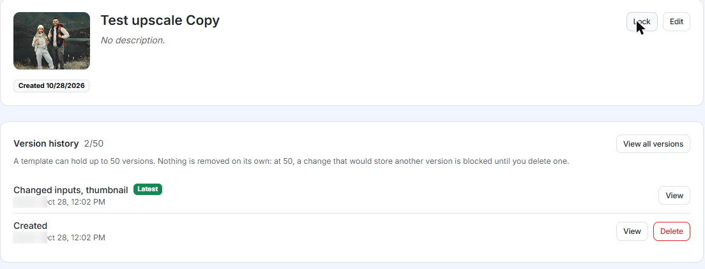
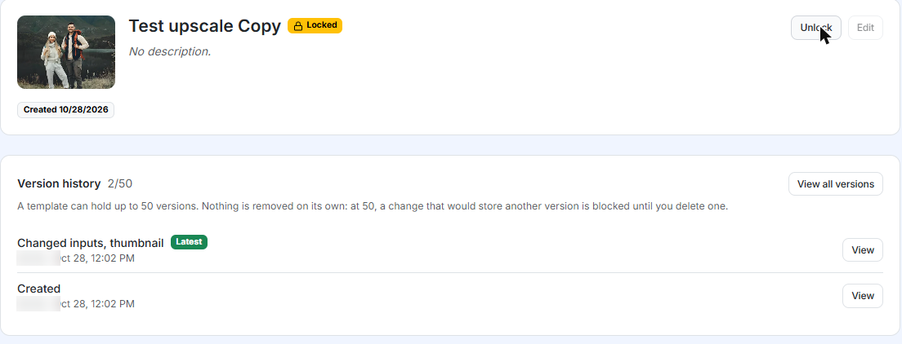
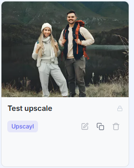
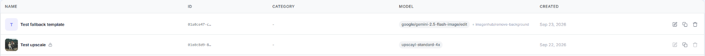
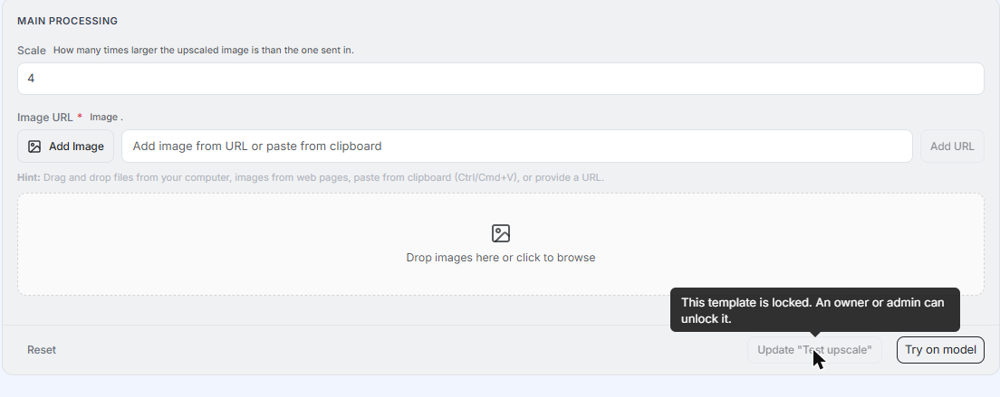
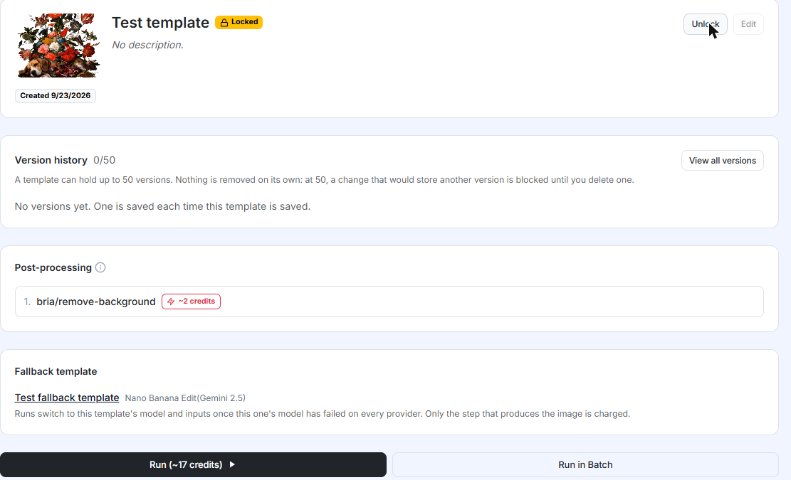
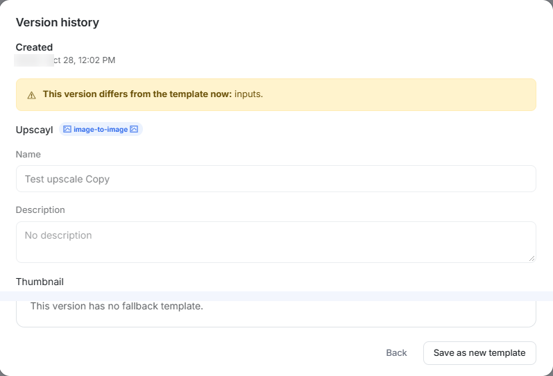
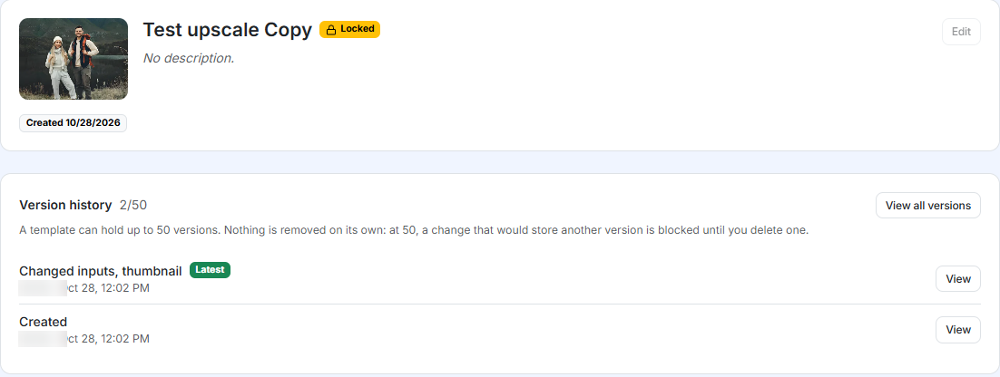

# Template Lock

A template is only as good as its last edit. One stray change to a prompt, a model, or a fallback can quietly alter every image the template produces afterwards, and if the template sits behind a live storefront or an API integration, nobody notices until customers do.

**Template lock** freezes a finished template. While it is locked, nobody can change it, not even owners and admins, but it keeps running exactly as before.

## When to use it

- **Approved templates behind a live flow**: a storefront, or your own API integration. Once a template is tuned and approved, lock it so it cannot drift.
- **Teams with several editors**: Editors can build and edit templates. Locking lets owners and admins decide when a live template is allowed to change.
- **Handing a template over**: you finish a template for your team and want it to stay exactly as delivered.

If you are still iterating on a template, leave it unlocked. Lock is entirely opt-in, and a template that was never locked behaves exactly as it always has.

## How it works

Locking is a switch on the template. Only an **Owner** or an **Admin** can turn it on or off (see [Roles](./organization.md#roles)). Editors and Viewers cannot.

| While a template is locked | What happens |
| --- | --- |
| Edit any part of the template (name, description, thumbnail, model, inputs, post-processing, fallback template) | Blocked for everyone, including owners and admins |
| Delete the template | Blocked |
| Revert to an older version | Blocked |
| Delete an old version | Blocked |
| Run the template (Playground, API, your connected apps) | Works as usual |
| Duplicate the template | Works. The copy is a new template that is not locked |

The lock is enforced everywhere a template can be changed: the web app, the AI Assistant (MCP), and the API.

::: tip Locking does not use up a version
Locking and unlocking do not add an entry to the version history. A template with 2 versions still shows 2/50 after you lock it, so locking never uses one of the 50 version slots.
:::

## Locking a template

1. Open the template you want to protect.
2. Click **Lock**, next to **Edit** at the top right of the template page.
3. A message confirms it: "Template locked. Nobody can change it until it is unlocked."

There is no confirmation dialog: the template locks as soon as you click.

Once locked, the title shows a **Locked** badge, the button becomes **Unlock**, **Edit** is greyed out, and the **Delete** buttons in the version history disappear.

## Unlocking a template

1. Open the locked template.
2. Click **Unlock**.

The badge disappears and the template can be edited again. To change a locked template, the usual routine is: unlock, make the change, lock again.

## Spotting a locked template

You can tell a template is locked without opening it. In card view, a small lock sits next to the name, and Edit and Delete are greyed out. Duplicate stays available.

In table view, the lock icon sits next to the name, and the Edit and Delete icons are greyed out in that row.

## What happens when someone tries to change it

Inside a locked template, everything that would change it is disabled. Hover over a disabled button to see why. The **Update** button, for example, shows "This template is locked. An owner or admin can unlock it." You can still use **Try on model**.

The model, inputs, post-processing steps and fallback template are still displayed, so you can check how a locked template is set up, but none of them can be changed.

If you update a locked template through the AI Assistant (MCP) or the API, the request is rejected and the template is left untouched. In MCP the message reads: "This template is locked. An owner or admin has to unlock it before it can be changed."

Templates returned by the API and MCP include a `locked_at` timestamp. It is `null` for an unlocked template and holds the time of locking for a locked one.

## Version history on a locked template

You can still open any version and read it. What changes is what the version dialog offers. On an unlocked template you can name a version and click **Revert to this version**. On a locked template both are gone, and only **Back** and **Save as new template** remain.

**Save as new template** creates a separate template from that version, and the new template is not locked. It is the way to reuse an old version without unlocking the original.

## What editors see

Editors can create and edit templates, but they cannot lock or unlock. On an unlocked template they see only **Edit**. On a locked template **Edit** is greyed out and there is no **Unlock** button. Hovering over **Edit** shows the same message about who can unlock it.

If an editor needs to change a locked template, ask an owner or an admin to unlock it first.

## Good to know

- **Everyone is blocked, not only editors.** Owners and admins cannot edit a locked template either. Unlock it first, make the change, then lock it again.
- **Runs are not affected.** A locked template keeps working in the Playground, through the API, and in your connected apps. Locking protects the template, not who can use it.
- **Locking does not hide anything.** Team members can still open a locked template and read its settings.
- **Duplicates start unlocked.** A copy of a locked template, whether made with Duplicate or with Save as new template from a version, is a normal template. Lock the copy as well if you want it protected.

## Next steps

- [Templates](./templates.md): how reusable presets store their inputs.
- [Fallback Template](./fallback-template.md): a backup template for when a model fails.
- [Organization](./organization.md): roles and what each of them can do.
