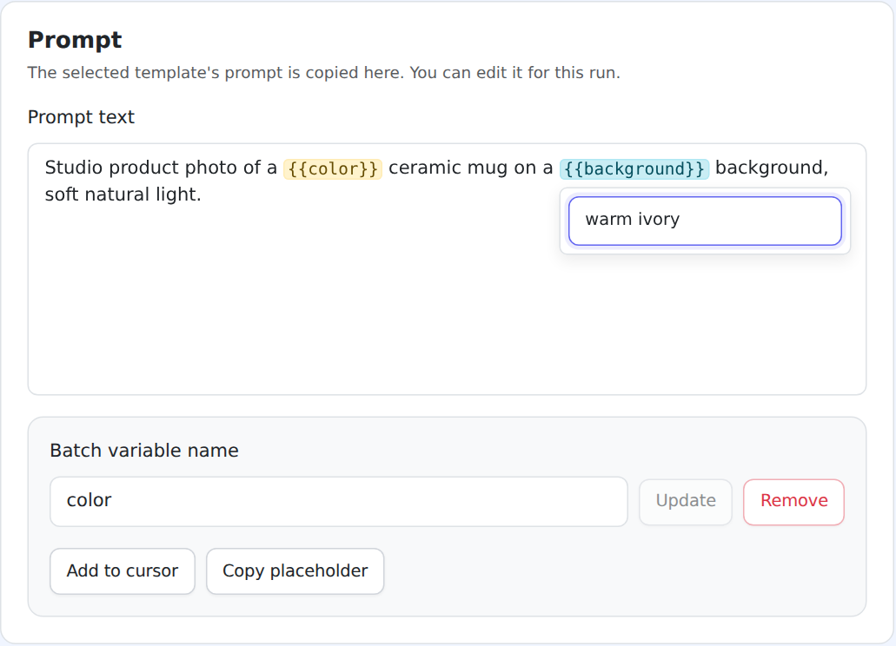
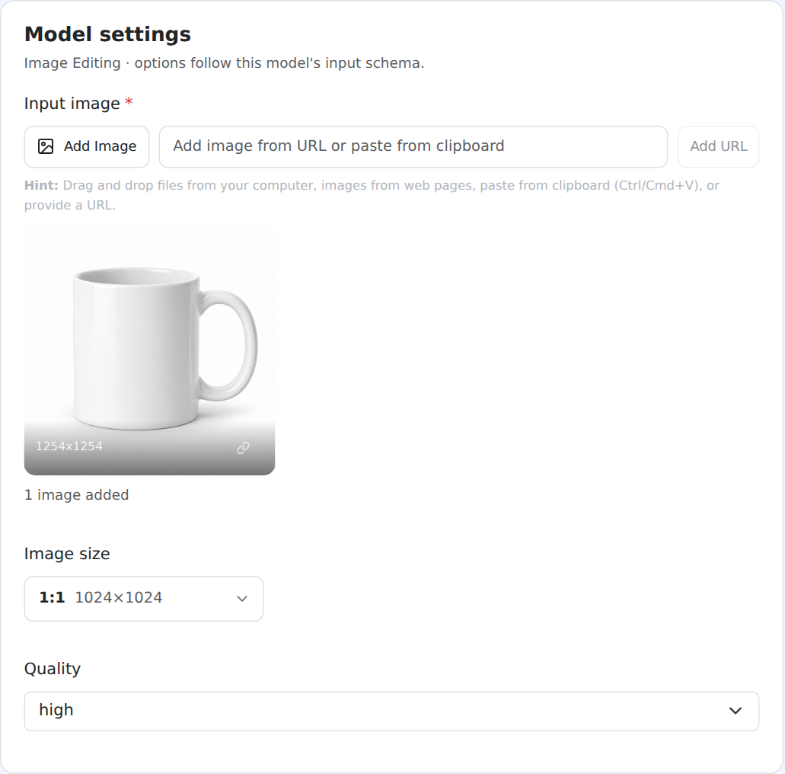
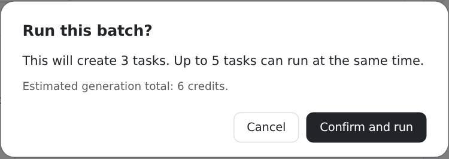
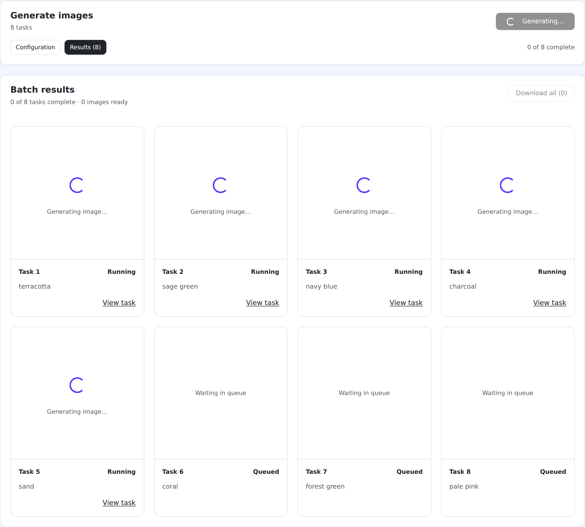

# Variable Runner

Turn one saved prompt template into a batch of image generations. Change a color, scene, style, or another part of the prompt for each task, keep the rest of the setup together, then download the results.

## When to use it

Use Variable Runner when you need to:

- **Explore product variations.** Try a list of colors, materials, or background descriptions with the same product photography prompt.
- **Compare creative directions.** Generate several scenes or visual styles without editing and submitting the same template for every idea.
- **Explore text and image variations.** Start from a text-to-image or image-to-image template, keep any shared input and reference images, and vary the prompt instructions across the batch.
- **Work through an existing list.** Paste values from your notes or import a TXT or JSON file, with one task planned for each value.
- **Keep shared settings together.** Use the same model settings and fixed prompt variables throughout a run, then review the results in one place.


_One template, three colors, three tasks. Example setup and estimate._

## How it works

Choose a template, add a batch variable to its prompt, and enter one value per line. Each value creates one task: three colors produce three tasks.

- **Shared setup.** Other prompt variables, model settings, and images stay fixed.
- **Preview first.** Check the first three resolved prompts in **Prompt Preview**.
- **Run the batch.** Add up to 250 values, with up to five tasks running at once.

### Before you start

Sign in to ImagenHub, then open **Batch → Variable Runner** in the sidebar. You do not need to enter an API key to use this page.

- Have a saved template of your own ready. If you need one, start with [Templates](./templates.md).
- Use a **text-to-image** or **image-to-image** model that accepts a text prompt. Models without a prompt input, such as a background removal model, cannot be used here.
- Make sure your organization role allows you to run tasks. A role that can only view the page cannot start a batch.
- Prepare any input or reference images required by your chosen model, and check the estimate before running.

### 1. Choose a template

Under **Prompt template**, search for and select one of your saved image generation templates.

The selected template's name and model appear below the picker. Its prompt is copied into **Prompt**, and its other saved inputs are loaded into **Model settings**. Use **View template** to inspect the saved template.

Your changes in Variable Runner apply to this run. They do not update the saved template.

#### Which templates can be used?

| Template | What to expect |
| --- | --- |
| Text-to-image with a prompt input | Supported. Prepare the prompt and any other required settings. |
| Image-to-image with a prompt input | Supported. Also provide the input and reference images the model requires. |
| Image model without a prompt input | Rejected when selected, even if the template contains saved prompt text. Choose a model that accepts a text prompt. |
| Video, audio, or another model type | Not supported by Variable Runner. |

A model with an optional prompt input is supported too. Variable Runner still needs you to enter a non-empty prompt for the run.

Switching templates clears the current batch values and loads the new template's prompt and settings. Finish or save any results you need before starting a different setup.

### 2. Prepare the prompt and batch variable

Edit **Prompt text** to describe the image you want. Put a placeholder where the text should change for each task, for example:

```text
Studio product photo of a {{color}} ceramic mug on a {{background}} background, soft natural light.
```

If the template already has prompt variables, the first one in the prompt is selected as the batch variable. Other variables keep their saved defaults until you change them.

If there is no batch variable yet:

- Enter a name such as `color` under **Batch variable name**.
- Click **Create variable**.
- Place the cursor where the value should appear in the prompt, then click **Add to cursor**. You can also use **Copy placeholder** and paste it into the prompt.

Creating the variable name alone does not insert its placeholder. Check that the prompt actually contains it before adding values.

#### What the variable controls mean

| Control | What it means |
| --- | --- |
| Batch variable name | The one variable that receives a different value for each task. Start with a letter or underscore, then use letters, numbers, or underscores. |
| Create variable / Update | Saves the variable name. When renaming an existing batch variable, **Update** also updates its matching placeholders in the prompt. |
| Add to cursor | Inserts the saved batch placeholder at the current position in the prompt editor. |
| Copy placeholder | Copies the placeholder, including its double braces, so you can paste it into the prompt. |
| Remove | Removes the batch variable selection and clears the batch values. It does not delete the placeholder text from the prompt. |

If **Unsaved changes** appears beside the variable name, click **Update** before using **Add to cursor** or **Copy placeholder**. A name that already belongs to another prompt variable cannot be used to rename the current batch variable.

#### Fill in fixed variables

For the example above, `color` changes across the batch while `background` stays the same. Click or hover over the `background` variable in the prompt and enter a value such as `warm ivory` in its popover.



_Use one fixed value for the background. The batch list supplies the color for each task._

Every fixed variable used in the prompt needs a non-empty value. Repeating the same batch placeholder several times uses that task's value in every occurrence.

### 3. Add your values

In **Variable values**, enter one value per line, up to 250 values:

```text
terracotta
sage green
navy blue
```

Empty lines are ignored. Commas stay inside a value, so `blue, with a matte finish` is one value and creates one task.


_The task count follows the number of values. Preview the substitutions before generating images._

The list starts empty even when the template has a default for the batch variable. Add the values you want to run. If a change would exceed 250 values, it is rejected and the previous list is kept.

#### Import a TXT or JSON file

Click **Import TXT / JSON** and choose a file from your device. Open **File formats** beside the import controls for examples.

| Format | What to put in the file |
| --- | --- |
| TXT | One value per line. Empty lines are ignored; commas stay inside each line. |
| JSON | An array of non-empty strings. Each string is one value, including any commas or line breaks inside it. |

For example, this JSON creates two tasks. The first value contains both a comma and a line break:

```json
[
  "terracotta, matte finish\nsubtle handmade texture",
  "sage green, glossy finish"
]
```


_JSON keeps a multiline instruction inside one value. Typing those same lines into the manual field would create separate values._

Files must be 1 MiB or smaller and contain no more than 250 values. Use readable text; binary files and unsupported control characters are rejected. JSON must be an array of strings, without empty or whitespace-only entries. CSV is not supported.

An accepted import replaces the active list and previews its first six values. **Use manual input** restores the values you typed before importing. If an import fails, fix the file and try again; your current list stays available.

### 4. Check the model settings

Review **Model settings** before running. These controls follow the selected model, so their names and available options can differ between templates.

- Set the output size, quality, or other options your model offers.
- For an image-to-image template, provide all required input images. Add reference images if the model supports them and your prompt needs them.
- Fix any required-field or validation messages before continuing.



_Image-to-image runs reuse the same input images and settings for every batch value. The text instructions change._

Variable Runner varies text inside the prompt. It does not assign a different uploaded image or a different model setting to each line in the values list.

### 5. Preview and run the batch

Read **Prompt Preview** and check the task count. With the sample values and a fixed `background` of `warm ivory`, the three tasks use:

| Task | Resolved prompt |
| --- | --- |
| 1 | Studio product photo of a terracotta ceramic mug on a warm ivory background, soft natural light. |
| 2 | Studio product photo of a sage green ceramic mug on a warm ivory background, soft natural light. |
| 3 | Studio product photo of a navy blue ceramic mug on a warm ivory background, soft natural light. |

Then:

- Check the estimate on **Run · N tasks**.
- Click **Run**. If a prompt, fixed variable, batch value, or required model input is missing, fix the displayed message and try again.
- In **Run this batch?**, review the task count and estimated generation total. If the template includes post-processing, review the notice about its separate charges.
- Click **Confirm and run** to start, or **Cancel** to return to the configuration.



_Review the count and estimate before confirming. Up to five tasks can run at the same time._

The page opens **Results** when generation starts. Keep it open while the queue runs. Template selection, prompt editing, batch values, and model settings are locked during generation. You can switch between **Configuration** and **Results** to inspect the run.

If you use a plain prompt with no active batch placeholder, Variable Runner creates a single task. Check the count before confirming if you expected a batch.

### 6. Review results and retry failures

**Batch results** shows a card for each task in the same order as the values list. The progress bar counts tasks that have finished, including failures.



_Each value has its own task card. Results appear as individual tasks finish._

| Status | What it means |
| --- | --- |
| Queued | The task is waiting for a free slot, or the remaining queue is paused. |
| Running | The task is being submitted or its generation status is being tracked. |
| Success | The task has a generated image ready to view and download. |
| Failed | The task could not finish successfully. Read its message and use **Retry** once the batch is no longer running. |

Click a generated image to open a larger preview. Use **View task** to open its task details in a new tab when a task has been created.

Some failures affect only one image, and the other tasks continue. A submission refusal, such as insufficient credits, or a problem tracking a task can pause the remaining queue. When **Batch paused** appears, address the error and click **Retry** on the failed task. The remaining queue resumes after the retry can proceed.

If generation may already have finished but status tracking was interrupted, retry checks the existing task before submitting it again. Review **View task** if you need to inspect its status.

### 7. Download or start again

- Click **Download** on a successful card to save that image.
- Click **Download all (N)** to save the currently successful images together in `variable-runner-results.zip`.
- Keep the page open while **Preparing ZIP** is displayed.

You can download successful results while other tasks are still running. A ZIP includes the images that were successful when you clicked **Download all**; results that finish later need another download.

If some downloads fail, the ZIP can still contain the files that were retrieved successfully. Read the message, then retry the missing downloads. Failed generation tasks are not included.

Before starting a new batch, download any results you want to keep from the current gallery. A new run replaces the gallery. Reloading or leaving the page also clears the current configuration and gallery; submitted tasks remain accessible in **Task History**. Wait for active generation to finish before navigating away.

## Good to know

- **One task per value.** Repeated values still create separate tasks. Shared settings help you compare variations, but generated images can differ even when the text is the same.
- **Use JSON for multiline values.** Manual input and TXT use line breaks to separate tasks; JSON preserves line breaks inside each string.
- **The placeholder must appear in the prompt.** Saving a batch variable name does not insert it. Use **Add to cursor** or paste the copied placeholder, then check **Prompt Preview**.
- **Fill every fixed variable.** Only the selected batch variable receives values from the list. Other placeholders need a fixed value in the prompt editor.
- **Choose a model that accepts prompt text.** Background removal and other image-only tools without a prompt input are rejected, including when opening a template directly from a link.

## Next steps

Start with two or three values, review the prompts and results, then expand the list when the setup works for you.

- [Templates](./templates.md) — prepare reusable models, prompts, and defaults.
- [Batch Editor](./batch-editor.md) — align, resize, replace backgrounds, and add shadows to a collection of images.
- [Dynamic Upload Ratio](./dynamic-upload-ratio.md) — let a template follow the shape of its input image.
- [Getting Started](./getting-started.md) — explore the wider ImagenHub workflow.
