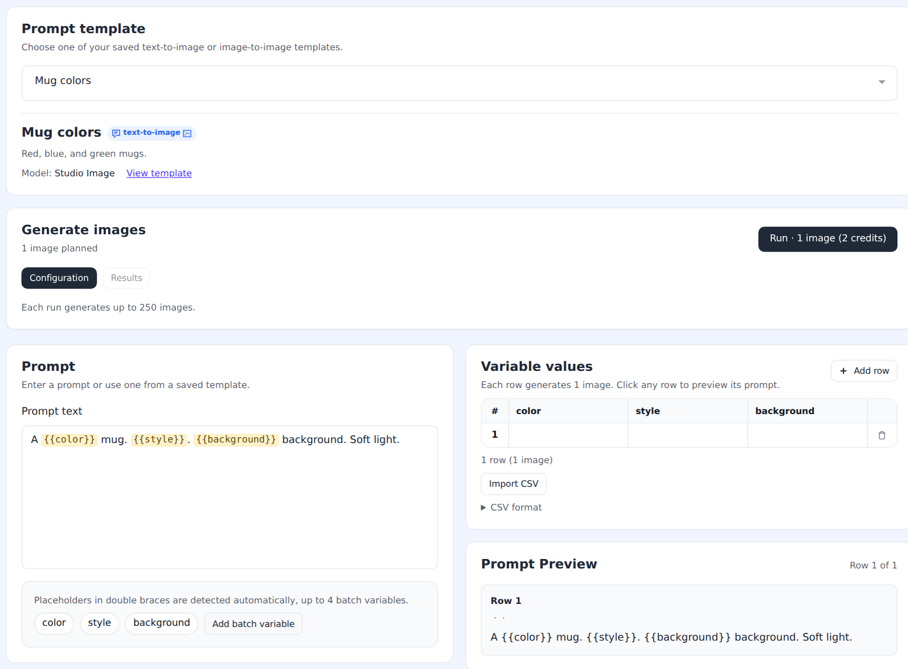
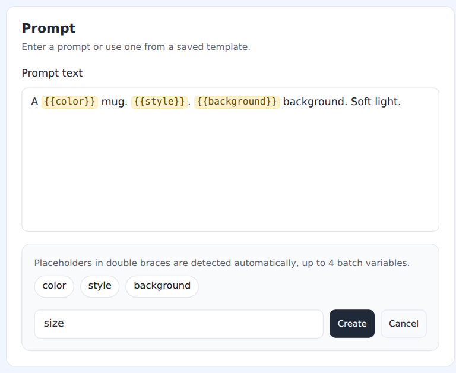
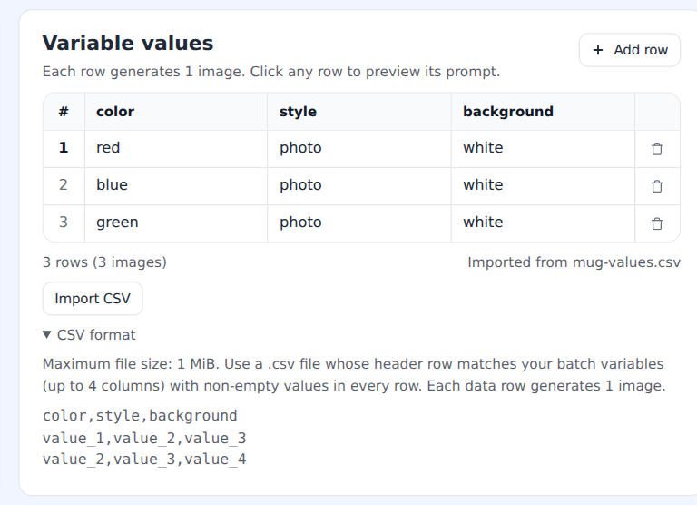
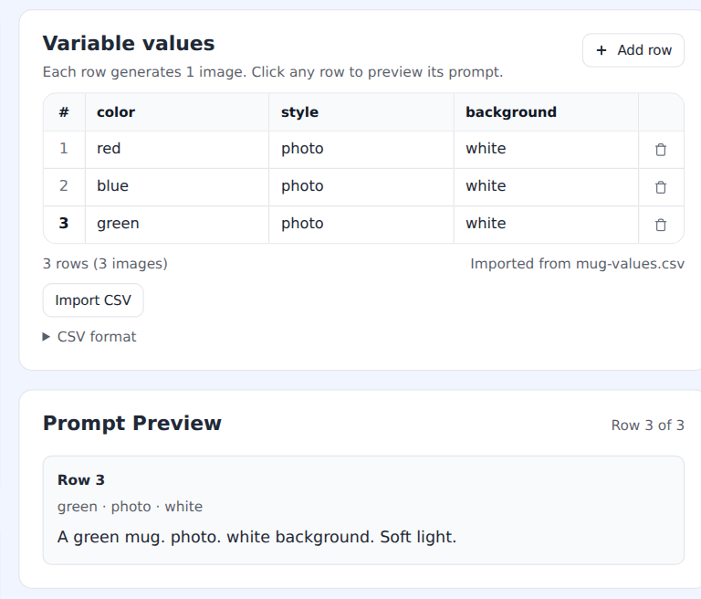
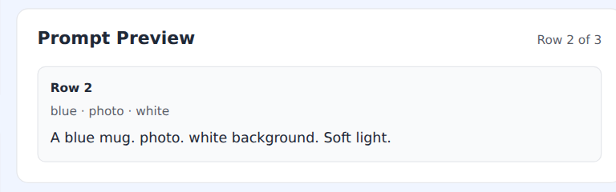
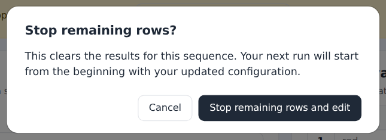

# Variable Runner

Use Variable Runner to run a saved template with different values for several prompt variables at once. For example, a template can have `color`, `style`, and `background` variables. Put their values in a table, with one column per variable. Each row uses those values together to make one image.

You can use up to **4 batch variables** per template. Three rows with the colors `red`, `blue`, and `green` make **3 images**. You can also change the style and background in each row.

Variable Runner works with both **text-to-image** and **image-to-image** templates.

## Before you start

Sign in and open **Batch → Variable Runner**.

- Have a saved [template](./templates.md) that uses a text-to-image or image-to-image model with a prompt field.
- Your account needs permission to run tasks. If the model needs an input image, have that image ready.

## 1. Choose a template

Select your template under **Prompt template**. Its prompt and model settings load into the page. **View template** opens the saved template.

Check **Model settings** for the image size, quality, and any required input images. These settings apply to every row.


Edits here apply to this batch. To switch templates, use the template picker again. Switching templates clears the current table.



## 2. Set up your batch variables

A variable marks a part of the prompt you want to change. Put its name inside double braces:

```text
A {{color}} mug. {{style}}. {{background}} background. Soft light.
```

The page finds `color`, `style`, and `background` and adds a column for each one. You can have up to **4 batch variables**. Fill the first row yourself, even if the template already has default values.

To add a variable using the form:

1. Click **Add batch variable**.
2. Enter a name such as `size` and click **Create**.
3. Type <code v-pre>{{size}}</code> into the prompt where you want its value to appear.

Start names with a letter or underscore. You can use letters, numbers, underscores, and spaces between words.



### Keep a variable fixed

Write shared instructions directly in the prompt. For example, `Soft light.` applies to every row.

If the prompt has more than four variables, the extra ones need one fixed value. Click or hover over an extra variable in the prompt and enter its value.

## 3. Enter or import values in the table

Fill in the cells under **Variable values**. Click **Add row** to add another image. Click a cell to edit it, or the trash button to delete its row.

Try these values:

| Row | `color` | `style` | `background` |
| --- | --- | --- | --- |
| 1 | red | photo | white |
| 2 | blue | photo | white |
| 3 | green | photo | white |

This makes a red mug, a blue mug, and a green mug. All three are photos on a white background.

Fill in every cell. If a required value is missing, clicking **Run** shows the row and variable to fix. Repeated rows still make separate images.

You can add more than **250 rows**. Each run makes up to **250 images**. Use **Run next** for the rows left over.


### Import a CSV file

Prepare your table in a spreadsheet and save it as a comma-separated `.csv` file. The first row must contain your batch variable names. Each row below it makes one image.

For the example above, save this as `mug-values.csv`:

```csv
color,style,background
red,photo,white
blue,photo,white
green,photo,white
```

Click **Import CSV** and choose the file. This replaces the current table. Click **CSV format** to see an example.

| Check | Rule |
| --- | --- |
| File size | Up to 1 MiB. |
| Columns | Include each batch variable once, with up to 4 columns. The column order can differ from the table. |
| Column names | Use the same names as your variables. `COLOR` also matches `color`. If you have both `color` and `Color`, match their spelling exactly. |
| Values | Fill every column. Empty rows are skipped. |
| Commas or line breaks inside a value | Put double quotes around the value. Write a quote inside it as `""`. |

If the file has an error, read the message, fix the file, and import it again. Your current table stays in place until the import succeeds.



## 4. Check the row order

Rows run from top to bottom. In this example, the order is:

| Row | Image |
| --- | --- |
| 1 | Red mug |
| 2 | Blue mug |
| 3 | Green mug |

To change the order, move the rows in your spreadsheet and import the CSV again. You can also enter them in the order you want using **Add row**.

Click a row to see its prompt below the table. Clicking row 3 shows the green mug prompt. **Run** still starts from row 1.



## 5. Preview and run

Check **Prompt Preview** before running. It shows the full prompt for the selected row. Click another row to check that one. If you edit a cell, its preview updates as you type.



1. Check the image count and credit estimate beside **Run**.
2. Click **Run**. Check the count and estimate in **Run this batch?**. Post-processing, if used by the template, has separate charges.
3. Click **Confirm and run**. The page opens **Results**. Keep it open while the images are being made. Up to five tasks can run at once.


A prompt with no batch variables makes one image.

### Continue a batch with more than 250 rows

For **253 rows**, the first run makes **250 images**. When it finishes, click **Run next** to make the last **3 images**. The second run uses rows 251–253 from the same table.


## 6. Review and download results by run

Each run has its own results page. Use **Results page**, **Previous**, or **Next** to switch pages. Cards follow the row order. The progress bar counts finished tasks, including failures.

- Click an image to see it larger. **View task** opens its task details.
- Click **Download** on a card to save that image.
- Click **Download all from Run N** to save the successful images on that page as a ZIP, up to 250 images. Switch pages to download another run.
- If you download while images are still being made, the ZIP contains only those already finished. Download again for later results.
- If a task fails, read its message and use **Retry** when available. If you see **Batch paused**, fix the reported problem and retry the failed task to continue. Retry checks an existing task before submitting it again when tracking was interrupted.


_This example has 253 rows. Run 2 shows the last three rows, with a red, blue, and green mug._

## 7. Stop a sequence or change the configuration

Save any images you want to keep first. Then click **Stop running remaining rows** in **Results**. This clears the current results and returns to **Configuration**. The next **Run** starts from row 1.

To edit while there are rows left, open **Configuration** and click **Stop remaining rows to edit**. Read the message and confirm. If all rows are already in the active run, the button says **End sequence to edit**.

You can then edit the prompt, table, or model settings. Tasks already running keep their original settings. Wait for that run to finish before starting again.



Reloading or leaving the page clears the table and results. Submitted tasks are still in **Task History**.

## Next steps

Try the three rows above first. Check the prompts and images, then add more rows or import your own CSV. Use **Run next** when you have more than 250 rows.

- [Templates](./templates.md) — save prompts and model settings.
- [Batch Editor](./batch-editor.md) — edit several images together.
- [Dynamic Upload Ratio](./dynamic-upload-ratio.md) — use the input image's shape in a template.
