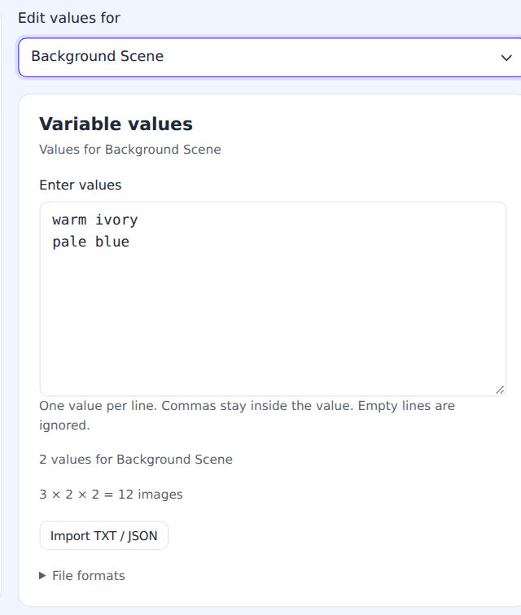
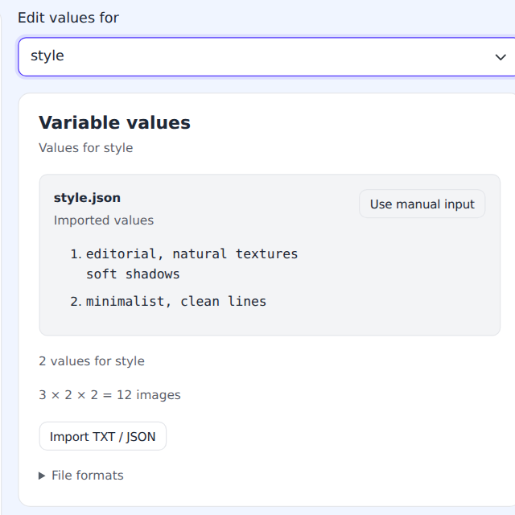
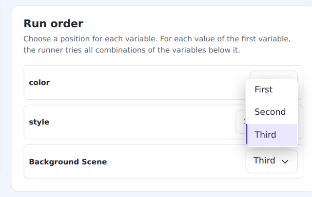
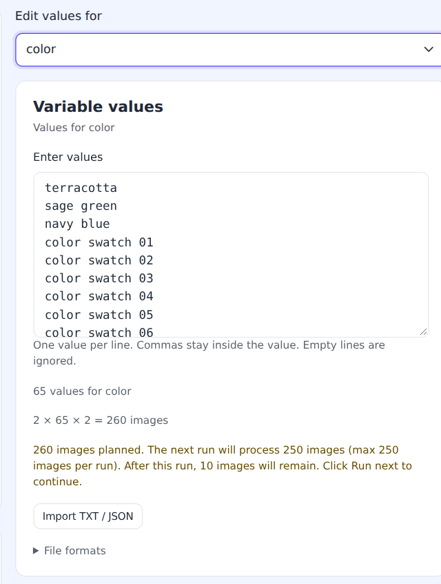

# Variable Runner

Use a saved prompt template to generate images for every combination of your batch values. Choose up to four variables to vary, keep the other prompt values and model settings fixed, and download the results for each run.

For example, three mug colors, two photography styles, and two scenes give you **3 × 2 × 2 = 12 images**. With one batch variable, three values give you three images.

## Before you start

Sign in to ImagenHub and open **Batch → Variable Runner**. You can run the batch from this page without entering an API key.

- Have a saved [template](./templates.md) of your own. Choose a text-to-image or image-to-image model that accepts a text prompt. A model with an optional prompt input also works, but Variable Runner still needs prompt text to run.
- Make sure your organization role allows you to run tasks. If you use an image-to-image template, have its required input and reference images ready.

## 1. Choose a template

Search for and select a saved template under **Prompt template**. The page loads its prompt and **Model settings**. Click **View template** to inspect the saved version. Changes you make in Variable Runner apply to the batch and leave the saved template as it is.

Review the output size, quality, and any required images under **Model settings**. All combinations use the same model settings and images. Switching to a different template clears your batch value lists and loads the new prompt and settings.


## 2. Set up your batch variables

Wrap each part of the prompt you want to vary in double braces. For example:

```text
Product photo of a {{color}} ceramic mug in a {{style}} style, on a {{Background Scene}} set, lit with {{lighting}}.
```

Variable Runner detects distinct placeholders when you load a template or edit the prompt. It adds up to four as batch variables. If a placeholder appears more than once, each occurrence uses the same value for that image.

You can also create a variable manually:

1. Click **Add batch variable**, enter a name, and click **Create variable**. Names can contain spaces between words, as in `Background Scene`. Start with a letter or underscore and use letters, numbers, underscores, or spaces.
2. Place the cursor in **Prompt text** and click **Add to cursor**, or use **Copy placeholder** and paste it. Creating a variable manually adds its name to the list. Its placeholder needs to be in the prompt for its values to affect the run.
3. To rename a variable, select it, edit its name, and click **Update**. The matching placeholders in the prompt update too.

### Keep a variable fixed

To use the same lighting for every image, select `lighting` in the list of batch variables and click **Remove**. The `{{lighting}}` placeholder stays in the prompt. Hover over or click it in the prompt editor and enter `soft window light`, or keep the saved default if it already has one. Fill in a value for every fixed placeholder used in the prompt.


## 3. Enter or import values for each variable

Use **Edit values for** to select a batch variable. In **Variable values**, enter one value per line or import a file. Then select the next variable and repeat. Each variable keeps its own list when you switch between them.

| Variable | Example values, one per line |
| --- | --- |
| `color` | terracotta<br>sage green<br>navy blue |
| `style` | editorial<br>minimalist |
| `Background Scene` | warm ivory<br>pale blue |

The count updates as you type or import. In this example, **Variable values** shows `3 × 2 × 2 = 12 images`, with one image planned for each combination. Repeated values count as separate entries. If a batch variable used in the prompt has no values yet, add at least one before running.

A value list can exceed **250 values**. The **250-image limit applies to each run**. If your total exceeds that limit, the notice tells you how many images will run next and how many will remain afterward.



### Import a TXT or JSON list

Select the variable you want to fill, then click **Import TXT / JSON**. The import replaces that variable's active list. Click **Use manual input** to restore its previous manual entries. If an import fails, the current list stays available.

| Format | How values are read |
| --- | --- |
| Manual input or TXT | One value per line. Empty lines are skipped, and commas stay inside a value. |
| JSON | An array of non-empty strings. Each string is one value and can include commas or line breaks. |

For example, save this as a JSON file to give `style` two values. The first value contains a line break:

```json
[
  "editorial, natural textures\nsoft shadows",
  "minimalist, clean lines"
]
```

Use a text file up to 1 MiB. Open **File formats** for examples. The import panel shows up to six entries from the file.



## 4. Choose the run order

When you have two or more batch variables, look for **Run order** below **Variable values**. Open the dropdown beside a variable and assign it a position such as **First** or **Second**. The other variables shift to make room.

For each value of the first variable, Variable Runner tries all combinations of the variables below it. The last variable changes fastest, and the values within each variable follow the order you entered them. Changing the order keeps the total image count the same and changes which images are processed first.



| Image | `color` → `style` → `Background Scene` | `Background Scene` → `color` → `style` |
| --- | --- | --- |
| 1 | terracotta · editorial · warm ivory | warm ivory · terracotta · editorial |
| 2 | terracotta · editorial · pale blue | warm ivory · terracotta · minimalist |
| 3 | terracotta · minimalist · warm ivory | warm ivory · sage green · editorial |

Put a variable first when you want to see everything for its first value before moving to the next. For example, put `Background Scene` first to review all colors and styles for `warm ivory` before moving to `pale blue`.

## 5. Preview and run

**Prompt Preview** shows the first five combinations in the upcoming run, or all of them if that run contains fewer than five. Check the values for each image and expand **View prompt** to read the full prompt, including fixed values.


1. Check **Generate images** for the total planned and **Run · N images** for the next run's size and credit estimate.
2. Click **Run**. In **Run this batch?**, check the image count and estimated generation total. If the template uses post-processing, review the notice about separate charges.
3. Click **Confirm and run**. The page opens **Results**. Keep the page open while the run processes up to five tasks at a time.


With no batch placeholders in use, a valid prompt and template can run as a single image.

### Continue a batch with more than 250 images

For example, **260 colors × 2 styles = 520 images**. **Run** starts the first 250. When that run finishes, click **Run next** for the next 250, then **Run next** again for the final 20. Each run starts where the previous one left off and uses the same prompt, values, order, and model settings. Check the remaining count before you continue.



## 6. Review and download results by run

Use the **Results page** dropdown or **Previous** and **Next** to switch between runs. Each page contains up to 250 results. The progress bar counts both successes and failures as completed tasks.

- Click a successful image to open a larger preview, or **View task** to inspect the task.
- Click **Download** on a card to save that image. **Download all from Run N** packages the successful images on the selected results page into a ZIP, up to 250 images per download. Switch pages and download each page separately to save the full sequence.
- If you download while a run is in progress, the ZIP includes only the images that had succeeded when you clicked. Download again for images that finish later.
- If an image fails, read its message and click **Retry** when available. If you see **Batch paused**, address the issue, open the paused run, and retry the failed task to let the queue continue. If status tracking was interrupted, retry checks the existing task before resubmitting it.


_In this example, the second run shows four sample images. Each mug matches the `color` value on its result card._

## 7. Stop a sequence or change the configuration

Download any results you want to keep before ending a sequence. In **Results**, click **Stop running remaining combinations** to discard the rest of the sequence and clear its results from this workspace. The button returns to **Run**, and the next run starts from the first combination.

If you switch to **Configuration** while a sequence is still active, the fields are locked. Click **Stop remaining combinations to edit** (or **End sequence to edit** when there are no remaining combinations) and review the confirmation. Any work already in progress uses its original configuration. After confirming, update your prompt, values, or order. Once the active run finishes, you can start a fresh run from the beginning.


Reloading or leaving the page clears the workspace configuration and results. Submitted tasks remain accessible in **Task History**.

## Related guides

- [Templates](./templates.md) for reusable prompts and model defaults.
- [Batch Editor](./batch-editor.md) for applying image edits to a collection of files.
- [Dynamic Upload Ratio](./dynamic-upload-ratio.md) for templates that follow the shape of an input image.
